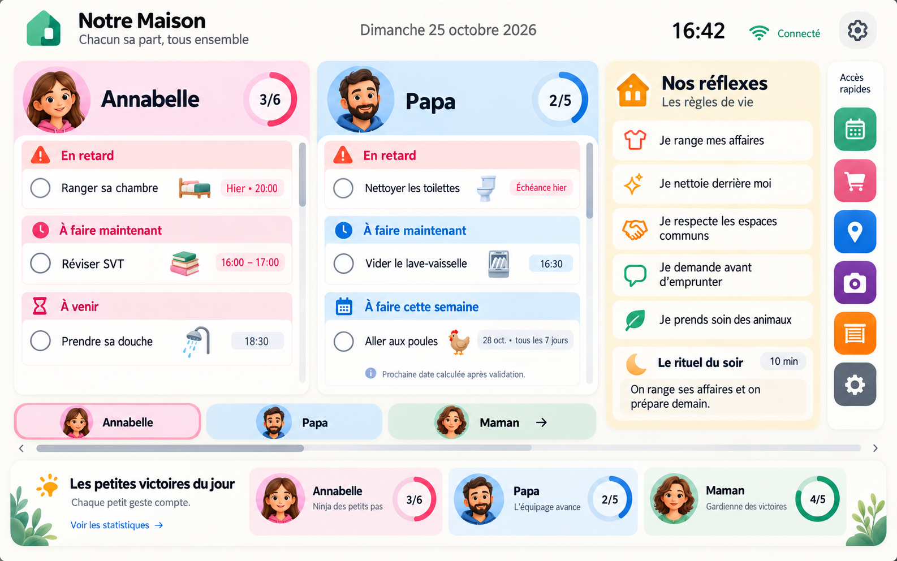
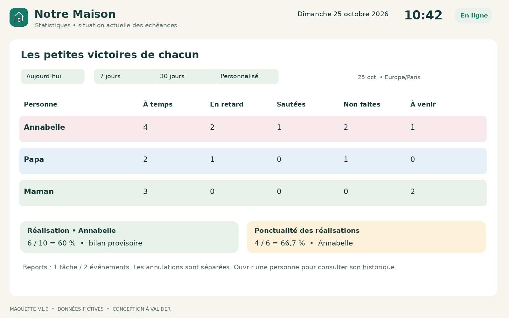
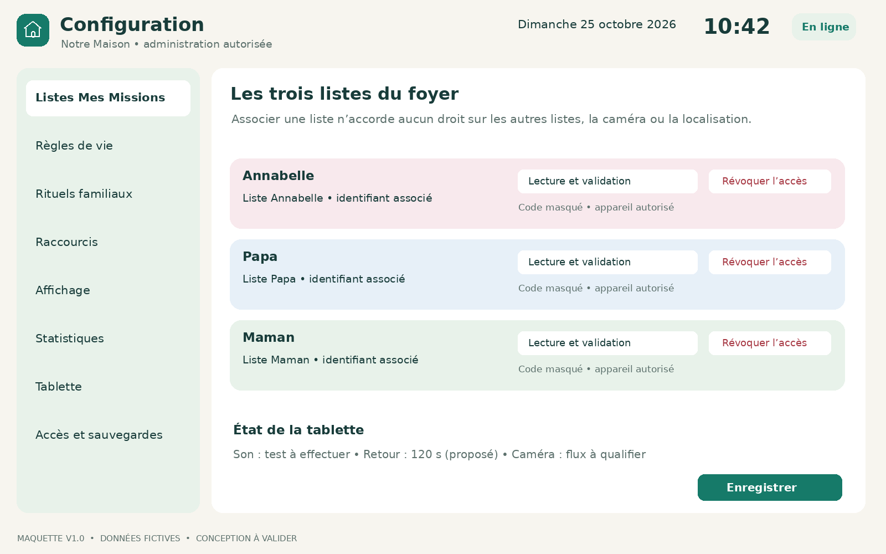
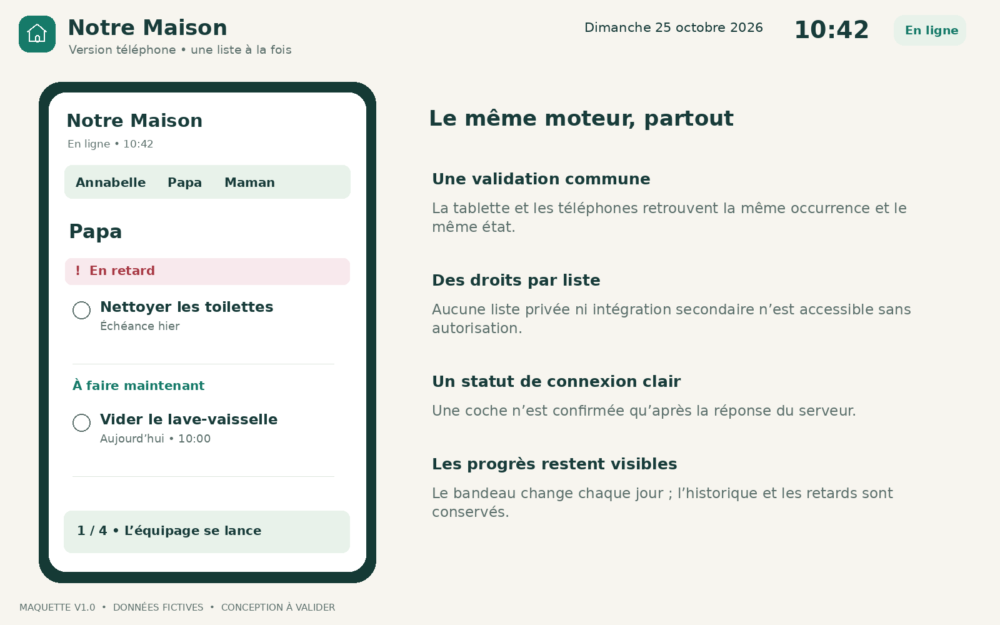
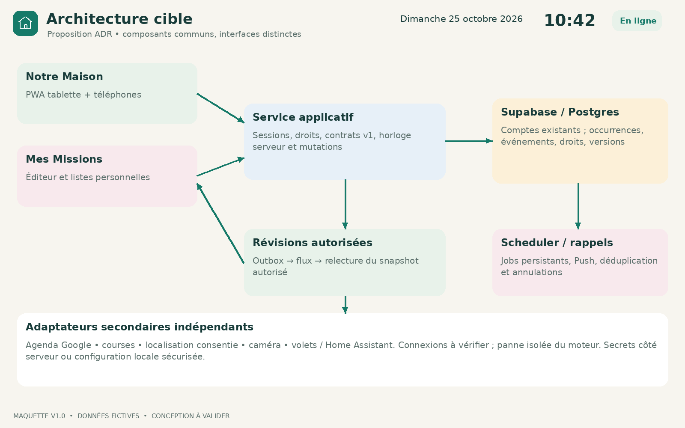

# Notre Maison + évolution de Mes Missions
## Cahier des charges fonctionnel et technique
Version 1.1 • 25 octobre 2026 • Référence NM-MM-CDC-1.1

Commanditaire : Laurie. Périmètre personnel et familial. Document de conception exploitable pour estimation, réalisation et recette ; aucune évolution applicative n’est déployée par ce livrable.

La V1.0 fixe les exigences exprimées et propose les arbitrages nécessaires à leur implémentation. Les propositions marquées H ou ADR restent à valider. Les paramètres illustrés ne sont pas des données familiales réelles.

## Gestion du document
| Version | Date | Objet | Statut |
|---|---|---|---|
| 1.1 | 25/10/2026 | Direction graphique validée et avatars modifiables ; EX67, T71–T73 | Mise à jour livrée |
| 1.0 | 25/10/2026 | Audit sources V10, dépôt et base ; spécifications, maquettes et recette | Livrée pour revue |

Une modification fonctionnelle crée une version mineure (1.1…), une correction éditoriale une révision (1.0.1…). Une rupture de contrat ou une migration incompatible crée une version majeure. Chaque révision conserve les identifiants d’exigences, le motif, la source, les impacts et les tests affectés. La validation de ce document ne vaut pas autorisation de modifier les systèmes mémoire, les comptes, la base ou la publication de production.

# 1. Résultat de l’audit de l’existant
## 1.1 Périmètre et méthode
L’audit a précédé la conception : lecture de l’échange partagé et de ses messages utilisateur, inspection de cinq images, récupération des archives V8.1, V9 et V10, lecture des modules applicatifs et SQL utiles, comparaison avec le dépôt fourni puis avec la page publiée, exécution locale des tests V10, consultation en lecture seule des métadonnées du projet Supabase.

Dépôt vérifié : https://github.com/lumawork/listes-nana. Branche main ; commit ac1beb58c59fae091906a3e4253afe0b84786520, daté du 19/10/2026 à 22:28:40, heure de Paris, intitulé « v10 multi users et partage de listes ». Page répondant HTTP 200 : https://lumawork.github.io/listes-nana/. Les 19 fichiers principaux à la racine du site sont identiques octet pour octet à l’archive V10 ; les huit fichiers centraux récupérés depuis la page publiée sont identiques au dépôt. Les illustrations supplémentaires du dépôt ne changent pas ce constat limité aux fichiers contrôlés.

Le projet listesnana référencé par config.js a été retrouvé et déclaré ACTIVE_HEALTHY, PostgreSQL 17, région eu-west-1. Les tables et signatures RPC existent en base ; la fonction de cycle a été lue. Aucune fonction applicative de lecture susceptible de capturer un historique n’a été exécutée : mm_shared_index, par exemple, écrit des observations. Aucune donnée métier n’a été modifiée. L’audit ne couvre pas une session familiale connectée ni le comportement physique Android : la tentative d’inspection visuelle distante a expiré. Les réglages Auth, les secrets, la planification et la réception Push ne sont pas intégralement certifiés.

## 1.2 Fonctionnalités constatées
| Élément | Vérification | Conséquence pour le projet |
|---|---|---|
| PWA statique HTML/CSS/JS | index.html, manifest, sw.js ; publication GitHub Pages | Réutiliser l’expérience Mes Missions et ses thèmes ; créer un portail distinct |
| Stockage personnel | localStorage, espaces par utilisateur, synchronisation versionnée Supabase | Exporter chaque appareil ; ne pas supposer que le serveur contient les dernières saisies locales |
| Profils et accès familiaux | family.js et SQL V9 ; schéma en base | Préserver les comptes et la confidentialité des listes privées adultes |
| Listes partagées | shared.js et mm_shared_* ; rôles owner/contributor | Réutiliser les droits par liste comme point de départ |
| Synchronisation partagée | setInterval de 10 s lorsque l’espace est visible | Ce n’est pas une diffusion temps réel ; mécanisme à faire évoluer |
| Coches communes | check avec valeur done explicite ; même état pour les participants | Une responsabilité accomplie reste une seule réalisation, même sur plusieurs appareils |
| Conflits et doublons | request_id, contrôle de révision, verrouillage SQL | Conserver et généraliser l’idempotence et les transactions |
| Cycles | daily, weekly ou manual ; reset des booléens done | Pas de moteur d’occurrences datées ; ne sait pas conserver le retard de chaque occurrence |
| Horaires | time indicatif sur tâche ; rappel commun au niveau liste | Ne pas présenter l’heure d’une tâche comme une alarme déjà opérationnelle |
| Notifications | Service Worker, abonnements, worker Push et SQL fournis | Réception réelle et ponctualité Android restent à tester |
| Historique | observations quotidiennes, rétention 30 jours | Ni journal exhaustif des événements, ni preuve horaire de chaque validation |
| Messages | paliers 50/80/100 ; bibliothèques enfant et adultes | Réutiliser textes et préférences ; ne pas confondre messages de progression et statuts quotidiens futurs |
| Sauvegarde | JSON personnel ; export séparé par liste partagée | La sauvegarde personnelle ne couvre pas automatiquement le partagé |

## 1.3 API effectivement présente
Contrats RPC constatés dans les sources et signatures retrouvées en base : mm_shared_contacts(), mm_shared_index(), mm_shared_create(p_list jsonb, p_source text, p_expected bigint, p_request uuid, p_actor uuid), mm_shared_apply(p_id uuid, p_action text, p_data jsonb, p_request uuid, p_day date, p_actor uuid). Les opérations de création, partage et coche sont des mutations ; elles n’ont pas été appelées en production pendant l’audit.

Le client gère notamment add, check, edit, delete_task, config, reset, snooze, role, leave et archive. Les listes V10 portent leurs tâches dans un payload JSONB ; leur état est un booléen done. Les tables mm_shared_lists, mm_shared_members, mm_shared_pending et mm_shared_requests sont dans mm_private, avec RLS et refus d’accès direct aux rôles clients ; les RPC contrôlent l’identité et les droits.

Aucun endpoint de flux dynamique par identifiant et code de liste, aucune récurrence relative à la dernière validation et aucun journal horaire par occurrence n’ont été trouvés dans les sources inspectées. Les codes d’invitation familiaux existants ne sont pas assimilables à un code révocable de liste. Aucune table applicative des schémas inspectés n’apparaît dans pg_publication_tables. Cela étaye l’absence de Postgres Changes sur ces tables ; le constat ne prétend pas inventorier toute infrastructure externe.

## 1.4 Résultats des vérifications
| Suite V10 relancée | Résultat original | Portée |
|---|---|---|
| shared-client | Passe | DOM simulé : partage, conflits, brouillons, réponses perdues |
| private-client | Passe | Profils privés, cache par compte, reprise, confidentialité |
| messages | Passe | Volumes, unicité, stabilité et styles |
| worker | Passe | Envois simulés, droits et destinataires |
| sw | Passe | Filtrage des notifications selon le compte |
| shared-database | Échec ligne 29 | Heure UTC codée en dur ; voir ci-dessous |

Le test SQL fixe dueAt à 06:00Z et attend un rappel local à 08:00. Le 25/10/2026, Paris est passé à UTC+1 : 06:00Z correspond à 07:00. Une copie locale ne changeant que 06:00Z en 07:00Z passe. Cela isole un défaut de robustesse du test au changement de saison ; ce n’est ni une correction du dépôt, ni la preuve que tous les cas temporels sont corrects. Les tests futurs utilisent une horloge injectée et des conversions IANA, sans décalage UTC fixe.

L’audit de sécurité Supabase remonte un avertissement : protection contre les mots de passe divulgués désactivée. Aucun changement n’a été fait. Les 18 tables applicatives inventoriées ont RLS activée ; cela ne dispense pas d’une revue des fonctions SECURITY DEFINER ni d’essais d’accès négatifs.

## 1.5 Risques de reprise
Le reset quotidien transforme la même tâche, sans conserver chaque occurrence non faite : il est incompatible avec le besoin de retard persistant. L’historique V10 ne permet pas de reconstituer honnêtement la ponctualité ancienne. La synchronisation personnelle utilise des snapshots et reste distincte des mutations partagées : un portail ne doit pas écrire directement ces blobs en parallèle. Les deux cycles doivent cohabiter uniquement pendant une transition contrôlée.

# 2. Sources, décisions et limites de preuve
## 2.1 Registre des sources
| ID | Source effectivement consultée | Usage |
|---|---|---|
| S01 | Demande actuelle du 25/10/2026 | Exigences explicites et priorité sur les esquisses |
| S02 | Échange partagé « Proposer un format familial » | Paroles utilisateur des 24 et 25 octobre, en ordre chronologique |
| S03 | image-1792834839039.jpg | Liste manuscrite des règles et ménage |
| S04 | 1000029917.jpg | Responsabilités, réflexes et rituel du soir |
| S05 | 1000029921.jpg | Intention de tableau familial et responsabilités |
| S06 | 1000029920.jpg | Habitudes et raccourcis |
| S07 | Maquette paysage originale, 1586 × 992, retrouvée dans S02 | Direction visuelle appréciée puis corrigée par Laurie |
| S08 | Dépôt GitHub et huit ressources HTTP du site publié | État du client V10 vérifié |
| S09 | Archives V10, V9 et V8.1 | SQL, tests, guides ; V10 est la base principale d’audit |
| S10 | Métadonnées listesnana et audit sécurité, lecture seule | Présence schéma/RPC, cycles et limites de configuration |
| S11 | Résultats locaux des six suites de tests | État reproductible de validation |
| S12 | Documentation éditeurs citée au chapitre 24 | Faisabilité et limites des composants proposés |
| S13 | Validation du nouveau visuel et demande d’avatars modifiables, 25/10/2026 | Direction graphique et EX67 |

Échange : https://chatgpt.com/share/6adda6f7-f0fc-83ed-a037-320b0d0d631c?ogimg=plain. Le manifeste Knowledge/00_Systeme_Memoire/00_Manifeste_et_routeur_V2.1 et le canon Nexus V2.1 ont été lus pour encadrer la recherche du contexte. Ils ne servent pas à inventer des fonctions de l’application. Aucune écriture dans Nexus, Atlas, Harmonie ou Tempo n’est réalisée.

## 2.2 Ordre des décisions et résolution des écarts
Les messages utilisateur récents et S01 priment sur les propositions antérieures de l’assistant et les exemples illustrés. Le choix final est Annabelle, Papa, Maman, avec deux listes visibles et défilement horizontal ; les règles restent fixes. Jonathan n’a pas de statistiques. Les raccourcis à droite affichent des icônes seules. Les retards sont en haut.

S07 montre encore des retards en bas, une statistique Jonathan, des libellés longs dans les raccourcis et une tâche terminée dans la liste. Ces éléments sont remplacés par les décisions récentes. La météo, les noms exacts des exemples, les ratios, les avatars et la date dessinée sont illustratifs, pas des exigences ni des données à importer. La date affichée dans cette ancienne maquette n’est pas une preuve d’échéance réelle.

Les liens vers applications n’impliquent pas une API de ces applications. Le portail distinct ne doit pas être réduit à un tableau Home Assistant ; Home Assistant reste une intégration secondaire. Les maquettes de cette livraison représentent la cible, jamais une capture de fonctions déjà réalisées.

## 2.3 Légende normative
E = exigence exprimée et à respecter. H = règle proposée pour lever une ambiguïté, avec valeur par défaut documentée. ADR = choix d’architecture proposé. V = vérification effectuée sur une source précise. O = question ouverte ou prérequis. Une réalisation peut commencer sur les parties indépendantes des questions ouvertes ; une bascule de production ne peut pas supposer leur résolution.

# 3. Finalité, périmètre et priorités
## 3.1 Objectifs
Faire de la tablette le point visible des responsabilités familiales, faciliter l’autonomie et réduire les relances de Laurie. Chacun peut consulter et valider depuis son téléphone. Les outils secondaires se consultent ponctuellement, puis le portail revient aux tâches. L’interface valorise les progrès sans classer ni humilier les personnes.

Mes Missions reste l’éditeur et le moteur des tâches ; Notre Maison est un portail distinct qui consomme le même moteur et les mêmes données. Une validation ne crée pas une copie locale indépendante. L’ajout d’un second appareil ne duplique ni la tâche, ni l’alarme, ni la statistique.

## 3.2 Priorisation
| Lot | Inclus | Condition de sortie |
|---|---|---|
| MVP cœur | Trois listes, occurrences datées, retards persistants, seuils d’apparition, récurrences fixes/relatives, horaires, validation multiappareils, partage sécurisé, affichage tablette/téléphone | Fonctionne sans intégration secondaire |
| MVP portail | Règles fixes, rituels et rappels, raccourcis URL/intents compatibles, retour inactivité, caméra verrouillable si flux validé | Les dépendances caméra et Android passent leur prototype matériel |
| MVP suivi | Historique, statuts quotidiens, vue globale/personne, reports/sauts tracés, export, administration | Calculs déterministes et migration vérifiée |
| Évolution E1 | Agenda intégré privé, liste de courses synchronisée native ou connectée, volets via HA, localisation consentie intégrée | Comptes, protocoles et droits vérifiés |
| Évolution E2 | Validation hors ligne avec conflits, regroupements avancés, automatisations additionnelles, usages supplémentaires | Valeur confirmée et sécurité testée |

Dans le MVP, Agenda/courses/localisation/volets peuvent être des raccourcis configurés. Leur simple présence ne promet pas une synchronisation de données ni une commande domotique. La caméra avec maintien de surveillance est un besoin majeur : son étude de faisabilité est un jalon bloquant pour la promesse de portail complet. Si un wrapper Android est indispensable au retour depuis les apps, il fait partie du lot tablette nécessaire, pas d’une fonction optionnelle masquée.

## 3.3 Hors périmètre initial
Aucune gestion médicale, prescription, notation des enfants, publication de localisation, enregistrement vidéo, écriture dans les systèmes mémoire, pilotage domotique automatique non demandé ni dépendance à un compte ChatGPT pour utiliser le foyer. Les règles de maison restent éditables par les parents ; le logiciel n’impose pas leur adoption.

# 4. Acteurs, droits et responsabilité
## 4.1 Modèle d’autorisation cible
L’identité (compte connecté), le rôle dans une liste, la responsabilité d’une tâche et le destinataire des rappels sont quatre propriétés distinctes. Le rôle propriétaire V10 donne aujourd’hui des rappels ; la cible doit dissocier administration et abonnement pour éviter qu’un parent soit obligé d’abandonner son pouvoir de gestion pour ne plus recevoir de rappels.

| Action | Administrateur du portail | Gestionnaire de liste | Participant validant | Lecteur | Tablette autorisée |
|---|---|---|---|---|---|
| Voir les listes | Celles autorisées | Celles autorisées | Celles autorisées | Celles autorisées | Trois liens explicitement associés |
| Valider | Si droit de validation | Oui | Oui | Non | Si option accordée pour la liste |
| Ajouter/modifier tâches | Si gestion accordée | Oui | Selon droit additionnel | Non | Non par défaut |
| Reporter/sauter | Selon droit liste | Oui | Si accordé ; sinon demande | Non | Non par défaut |
| Gérer accès/code | Non implicite | Oui | Non | Non | Non |
| Configurer règles/raccourcis | Oui | Non implicite | Non | Non | Après authentification administrateur |
| Voir statistiques nominatives | Selon périmètre autorisé | Liste autorisée | Périmètre accordé | Périmètre accordé | Synthèse familiale explicitement choisie |
| Caméra/localisation/volets | Droit secondaire séparé | Non implicite | Non implicite | Non implicite | Seulement accès configuré |

Deux parents administrateurs du portail sont proposés, sous réserve de leurs comptes réels. Un adulte n’est pas supervisé comme un enfant. Le compte Annabelle garde le périmètre familial déjà autorisé ; aucun élargissement de droit n’est déduit d’un nom ou d’un thème.

Une tâche a un responsable unique pour les statistiques personnelles. Celui qui coche est actor_user_id ; la personne concernée est assignee_person_id. Si Maman aide Papa et coche sa tâche, le crédit de responsabilité va à Papa avec la mention « validé par Maman ». Sur tablette partagée sans identification nominative, l’acteur est l’appareil ; aucune identité humaine n’est inventée. Une action que chacun doit faire génère une occurrence par personne, pas une liste commune à cocher une seule fois.

# 5. Parcours et interface Notre Maison
## 5.1 Écran permanent tablette
Cible : tablette Android 10 pouces paysage, viewport ≥ 1024 × 600 pixels CSS. Tester aussi les écrans physiques 1280 × 800 et 1920 × 1200 selon leur densité. Sous le minimum, proposer un mode compact lisible ou le mode téléphone.

Disposition : titre/date/heure et fraîcheur réseau en haut ; deux listes majoritaires ; règles fixes ; icônes à droite ; trois synthèses et rituel au pied. Aucun scroll vertical global à la taille cible. Chaque liste défile verticalement ; seule leur zone défile horizontalement, avec scrollbar, flèches et repères. Glisser ne coche jamais une tâche.

Positions : Annabelle + Papa puis Papa + Maman ; ordre configurable. Règles, raccourcis et pied restent immobiles. Le rail des règles peut défiler intérieurement si nécessaire, avec titre toujours visible ; l’aperçu signale les textes trop longs sans troncature silencieuse.

## 5.2 Carte et classement d’une tâche
Chaque ligne affiche un contrôle de validation d’au moins 48 pixels CSS, le titre, une échéance lisible avec date si nécessaire, le type de récurrence, un statut textuel et un menu d’actions. Les couleurs renforcent le texte, sans le remplacer. La section « En retard » est toujours en premier, plus ancienne fin de ponctualité en tête ; viennent « À faire maintenant », puis « À venir ». À échéance égale, priorité manuelle puis identifiant stable. Une ligne cochée disparaît des actives après confirmation serveur et reste consultable dans l’historique.

Le changement à distance conserve le défilement, le focus et la saisie. Une réponse réseau perdue n’autorise pas une deuxième réalisation ; le contrôle montre « vérification en cours ». Hors connexion, les anciennes valeurs sont datées et les actions sont désactivées dans le MVP. Le bouton Actualiser permet la resynchronisation explicite.

## 5.3 Parcours essentiels
P1 : un gestionnaire crée une tâche, choisit responsable, type, première échéance, récurrence et rappels ; un aperçu présente les trois prochaines occurrences ou le prochain calcul relatif. Il enregistre puis retrouve la même définition dans Mes Missions et Notre Maison.

P2 : Annabelle coche sur son téléphone ; le serveur confirme ; la tablette retire cette occurrence et met à jour les statistiques. Deux coches simultanées produisent une seule réalisation.

P3 : un participant ouvre « Je passe mon tour » ; selon ses droits il choisit Sauter, Reporter ou Demander de l’aide. Le motif est facultatif sauf politique familiale explicitement choisie. Aucune action n’est assimilée à une réalisation.

P4 : un parent consulte un service secondaire puis l’inactivité ramène aux tâches. Le verrou caméra suspend ce retour jusqu’au déverrouillage.

P5 : un parent ajoute une règle ou un raccourci depuis son téléphone, voit un aperçu tablette et publie la configuration après contrôle de version. L’écran tablette l’applique sans perdre ses coches.

## 5.4 Téléphones
Sur petit écran : une liste à la fois, onglets des seules personnes autorisées, accès aux règles et statistiques. La tablette paysage conserve deux listes. Portrait, zoom à 200 %, clavier et encoche ne masquent aucun bouton.

# 6. Maquettes de référence livrées
Les cinq vues suivantes sont des propositions de conception V1.0, avec données fictives et couleurs adaptables. Elles ne simulent pas une connexion réelle. Les fichiers haute résolution sont inclus dans le dossier maquettes et le dossier complet.

## M01 — Tâches en paysage

Le rail horizontal montre les trois personnes ; la troisième se révèle sans déplacer les règles. Le bandeau inférieur met Maman à la place de Jonathan. L’état de connexion et la date de fraîcheur sont visibles ; aucun pourcentage ne prétend exploiter l’ancien historique de ponctualité.

## M02 — Statistiques globales et individuelles

Ouverture en volet/modal accessible ; filtre période et personne ; grille détaillée, aide sur le dénominateur et accès aux événements. Les reports sont des événements, pas une catégorie additionnée aux réalisations.

## M03 — Administration

Listes associées par identifiant et association révoquable, explications textuelles pour les raccourcis, état des capacités tablette. Le code n’est pas réaffiché en clair après l’association.

## M04 — Caméra et retour

La zone vidéo est un espace fictif, sans image de chambre. Un verrou visible signifie « maintien de surveillance », sans promettre un verrouillage système. En cas de flux interrompu, une alerte persistante remplace toute apparence de direct.

## M05 — Téléphone

La validation, l’échéance et le retard restent les mêmes sur les deux applications. Le retour automatique du mode tablette est désactivé par défaut sur le téléphone ; un réglage séparé est possible.

# 7. Modèle temporel et échéances
## 7.1 Définitions à ne pas confondre
Définition : modèle permanent d’une tâche. Occurrence : action attendue à une échéance donnée. visible_at : instant où elle apparaît. due_at : heure cible. on_time_end : borne exclusive de fin de ponctualité. reminder_at : instant de sonnerie. completed_at : validation confirmée par le serveur. Les calculs utilisent une horloge serveur, stockent des timestamptz UTC et conservent timezone Europe/Paris et les dates civiles de référence.

Une échéance peut être une heure exacte, une période, une journée sans heure ou une action manuelle sans date. L’administration interdit une tâche « datée » sans première échéance. Sans date, elle est visible immédiatement dans « Sans échéance », sans retard ni mesure de ponctualité. Les tâches ponctuelles datées ont une anticipation paramétrable, proposée à 5 jours pour une journée et 2 h pour une heure exacte (H02).

## 7.2 Fenêtres d’apparition
| Type de planification | Apparition | Source / statut |
|---|---|---|
| Matin / après-midi / soir | Début de la période moins 4 heures | E ; prime sur la fréquence |
| Fréquence nominale > 24 h | Échéance moins 5 jours | E ; calcul civil proposé H02 |
| Fréquence nominale ≤ 24 h, heure exacte | Échéance moins 2 heures | E ; inclut exactement 24 h |
| Occurrence en retard | Visible en tête tant qu’ouverte | E ; même après changement de jour |
| Sans échéance | Immédiatement | H02 ; aucune ponctualité calculée |

H02 : les 5 jours sont des jours civils à la même heure locale ; 2 h et 4 h sont des durées écoulées. visible_at est plafonné à created_at si le résultat est antérieur à la création. La publication d’un modèle futur n’avance pas son activation. La fréquence de référence est nominale : une routine quotidienne reste « 24 h » même si sa journée dure 23 ou 25 h lors du changement de saison.

## 7.3 Ponctualité et cas exactement 24 h
| Type | Fenêtre proposée de réalisation dans les temps | Limites |
|---|---|---|
| Fréquence < 24 h, heure exacte | De due_at à min(due_at + 1 h, prochaine échéance fixe) | H03 : borne haute exclusive, évite le chevauchement si récurrence < 1 h |
| Période | Du début inclus à la fin exclue de la période | E ; période prioritaire sur fréquence |
| Fréquence > 24 h | Journée civile de l’échéance | E ; de 00:00 à 00:00 du lendemain |
| Fréquence = exactement 24 h | Journée civile de l’échéance | H01 : proposition explicite, apparition reste 2 h avant l’heure cible |
| Ponctuelle | Selon son type : heure + 1 h, journée ou période | H03 ; configurable et versionné |

Une réalisation anticipée est autorisée seulement quand l’occurrence est visible ; elle est étiquetée « en avance » et agrégée dans les réalisations dans les temps (H03). Avant visible_at, une action « faire en avance » réservée au gestionnaire demande confirmation et génère un événement spécifique. Le mode relatif repart alors de cette validation anticipée. À on_time_end exactement, la tâche devient en retard. « Dans l’heure » signifie une tolérance après l’heure cible et non une fenêtre arbitraire centrée sur elle ; cet arbitrage doit être confirmé.

H04 : le bandeau « En retard » est déclenché à on_time_end, pour rester cohérent avec la statistique. Entre due_at et on_time_end, le texte peut afficher « heure cible passée, encore dans les temps ». Si Laurie souhaite un retard visuel dès l’heure cible, l’interface devra distinguer clairement « échéance dépassée » et « réalisée dans les temps ». Cette variante ne doit pas changer secrètement les indicateurs.

## 7.4 Périodes et temps civil
H05 propose Matin 06:00–12:00, Après-midi 12:00–18:00, Soir 18:00–22:00. Les heures sont configurables par foyer ; aucun intervalle ne se chevauche. Une période traversant minuit porte une date d’ancrage et se termine le lendemain ; sa ponctualité suit l’intervalle complet. Une validation à 12:00 appartient à l’après-midi, pas au matin. Le changement des périodes ne recalcule que les occurrences futures non publiées, sauf migration explicite.

Pour une heure locale inexistante au printemps, H06 propose le premier instant valide suivant ; pour une heure répétée à l’automne, la première occurrence de cette heure, avec un seul identifiant d’alarme. L’aperçu montre le décalage. Un intervalle strict de 24 heures écoulées peut être choisi explicitement : il ne remplace pas un jour civil. L’interface nomme ces deux modes séparément.

# 8. Moteur des récurrences et cycle de vie
## 8.1 Modes
FIXED_CALENDAR : jours de semaine, heure/période, éventuellement intervalle en jours/semaines ; chaque occurrence possède un identifiant stable, même si la précédente est en retard. AFTER_COMPLETION : la prochaine échéance naît à partir de la dernière validation ; une seule occurrence ouverte par définition et responsable. ONE_OFF : une occurrence unique. MANUAL : aucune nouvelle occurrence automatique.

L’accumulation des occurrences fixes est voulue : les non-cochées restent. L’interface peut grouper visuellement « 5 occurrences en retard » avec détail et actions explicites, jamais les supprimer. Une occurrence relative non faite bloque la suivante : passer 21 jours sans cocher « poules » ne crée pas artificiellement trois nettoyages dus. Une tâche fixe et une tâche relative ne partagent pas le même algorithme.

## 8.2 Exemple obligatoire : poules tous les 7 jours
H07 propose « 7 jours civils après validation, même heure locale ». Validation le 25/10/2026 à 10:00 Paris : prochaine échéance le 01/11/2026 à 10:00 ; apparition le 27/10 à 10:00 (J−5) ; sonnerie à l’heure configurée selon la politique de rappel. Si validation seulement le 28/10 à 11:30 : prochaine échéance le 04/11 à 11:30, sans rappel fixé au dimanche. Si l’utilisateur choisit plutôt 168 heures écoulées ou une heure cible fixée au premier créneau suivant, ce choix doit être visible, distinct et validé.

Une première échéance est demandée lors de la création si aucune dernière réalisation fiable n’existe. L’historique ancien ne fournit pas cet instant : ne jamais l’inventer. Une coche faite sur deux appareils ne décale pas deux fois l’échéance suivante.

## 8.3 États et transitions
OPEN se décline en planned, upcoming, due ou overdue, calculés à partir du temps. Les issues persistées sont COMPLETED, SKIPPED et CANCELLED. Un report laisse l’occurrence OPEN et ajoute un événement RESCHEDULED avec ancienne/nouvelle échéance ; ce n’est pas une issue terminale. Une pause du modèle bloque la génération future et les rappels, sans clôturer les retards existants.

Valider : OPEN → COMPLETED, avec actor et completed_at serveur ; calcul d’issue, clôture des rappels, génération relative suivante dans la même transaction. Répéter la même demande retourne le résultat précédent. Valider une occurrence déjà accomplie renvoie son résultat, sans nouvel événement de réalisation. Reporter exige une date ultérieure et un motif facultatif ; toute demande d’une date passée est refusée dans le MVP.

Sauter : OPEN → SKIPPED, avec choix explicite. Pour une récurrence fixe, la suite reste au calendrier. Pour une relative, H08 exige un choix « reprogrammer cette occurrence » ou « sauter et fixer la prochaine échéance » : la dernière validation ne change pas. Impossible de déduire une réalisation d’un saut. Annuler signifie « devenue inutile » ; action gestionnaire avec justification, séparée d’un échec.

Réouvrir une réalisation est une correction tracée, jamais la suppression d’événements. Pour un modèle relatif : si la suivante est encore vierge, elle peut être annulée puis la précédente réouverte atomiquement ; si elle a déjà été traitée ou modifiée, conflit à résoudre par le gestionnaire. La correction conserve ancienne valeur, auteur, date et raison. Une suppression de modèle est une archive ; les occurrences et l’historique demeurent selon la rétention.

## 8.4 Invariants et génération
Au plus une occurrence par (definition_id, assignee_id, recurrence_key). Pour le relatif, un champ schedule_type capturé sur l’occurrence permet un index unique partiel (definition_id, assignee_id) WHERE schedule_type = AFTER_COMPLETION AND status = OPEN ; le serveur garantit sa cohérence avec la définition. La génération fixe utilise une fenêtre glissante jusqu’à J+35 (H09), s’exécute côté serveur et au rattrapage après panne ; la clé stable empêche les doublons. Les nouvelles définitions actives depuis longtemps demandent la date de début ; aucun passé artificiel n’est généré sans confirmation.

Modifier le titre ou le responsable ne réécrit pas les occurrences terminées. Modifier une règle crée une nouvelle révision effective à partir d’une date ; les instances déjà visibles sont maintenues ou transformées par une opération explicite avec aperçu d’impact. Réaffecter un retard n’efface pas le responsable d’origine ni son cohortage statistique.

# 9. Rappels, sonneries et rituels
## 9.1 Politiques de rappel
Les politiques se configurent par tâche et par rituel, avec héritage de liste possible : activé, destinataires, appareils, heure/décalage, son, volume souhaité, relances, jours autorisés, plages silencieuses. L’heure d’apparition n’est pas une sonnerie. Le réglage affiche un aperçu concret : « visible mardi à 10 h, rappel dimanche à 10 h ».

Pour AFTER_COMPLETION, H10 propose le rappel initial à due_at, avec possibilité d’une heure locale de notification indépendante sur la date d’échéance. Ainsi, un rappel à 09:00 n’avance pas l’échéance recalculée à 11:30. Les reports de sonnerie de 15 minutes déplacent le rappel, pas la tâche. Les reports de tâche modifient effective_due_at et recalculent les rappels ; les deux actions portent des libellés différents.

Les relances s’arrêtent après réalisation, saut, annulation, révocation, pause ou expiration du rappel. Limite proposée : un rappel initial et deux relances par occurrence et appareil, espacées d’au moins 15 minutes (H10). Une plage silencieuse reporte au prochain créneau autorisé seulement si l’action est toujours pertinente ; le retard reste visible. Les notifications périmées à la reconnexion sont regroupées dans un bilan, pas rejouées en rafale.

## 9.2 Acheminement et limites matérielles
Au premier lancement tablette, une action « Activer et tester le son » amorce l’audio ; le navigateur peut bloquer la lecture sans geste utilisateur. Le portail indique son activé, volume à vérifier et dernière sonnerie test. Il ne peut pas imposer le volume système ni désactiver Ne pas déranger depuis une PWA ordinaire. Les contraintes Chrome sont documentées en S12.

Un scheduler serveur alimente des jobs persistants. Chaque envoi revérifie droits, état et fraîcheur ; clé unique (occurrence, politique, étape, canal, appareil). Le client au premier plan et le Push se coordonnent par cette clé. Une émission répétée ne produit pas deux alarmes. Le worker reprend une tâche échouée avec backoff et échéance de validité. Les statuts planifié, pris en charge, envoyé, reçu si acquitté et erreur restent distincts : « envoyé » ne signifie jamais « entendu ».

Objectifs proposés : au premier plan, sonnerie dans les 5 s de l’instant cible sur tablette de référence ; propagation d’annulation dans les 5 s en ligne ; Push observé et mesuré, sans garantie de délai Android en arrière-plan. Si une alarme fiable écran éteint est impérative, un composant Android local doit être validé avant de promettre ce service. Un rappel manqué devient visible avec raison technique disponible.

## 9.3 Rituels familiaux
Un rituel porte titre, description, durée indicative, jours, horaire, rappel et destinataires. Le « rituel du soir — 10 min — chacun remet ses affaires en ordre et vérifie ses responsabilités » provient des images ; les jours et heures restent à choisir. Par défaut, une règle ou un rituel n’entre pas dans les statistiques individuelles. Si un rituel engendre des tâches, son mode l’annonce et crée une seule occurrence liée par participant ; le rappel du rituel et celui des tâches ne se cumulent pas sans choix explicite.

# 10. Statistiques, événements et encouragements
## 10.1 Indicateurs
Le tableau global présente Annabelle, Papa et Maman ; aucun profil statistique Jonathan n’est créé. Une vue par personne détaille la période, la liste, les occurrences et les corrections. Filtres proposés : aujourd’hui, 7 jours, 30 jours, plage personnalisée. La date civile et le fuseau utilisés sont indiqués.

Le suivi de ponctualité repose sur la cohorte des occurrences dont la date d’échéance d’origine appartient à la période. Chaque occurrence compte au plus une fois. À l’instant de consultation, D est l’ensemble de ces occurrences publiées et non annulées ; elles se répartissent sans recouvrement en réalisées dans les temps (T), réalisées en retard (L), sautées (S), ouvertes non faites après fin de ponctualité (N), et ouvertes encore dans les temps / à venir (A). D = T + L + S + N + A. Les annulations sont montrées à part et exclues du dénominateur, avec raison et compteur.

Taux de réalisation finalisée = (T+L)/D, avec indication « provisoire » tant que A > 0. Taux de ponctualité des réalisations = T/(T+L). Ces deux taux portent des noms distincts ; si le dénominateur vaut zéro, afficher « — aucune donnée », pas 0 % ni 100 %. Le taux global agrège les compteurs, sans moyenne des pourcentages individuels. Un filtre de liste duplique visuellement des accès, jamais les occurrences.

## 10.2 Retards, reports et perspective temporelle
Une occurrence non faite reste ouverte et peut être réalisée plus tard : N devient L dans la lecture actuelle de la cohorte. L’historique événementiel conserve ce qu’il s’est passé et quand. Des snapshots quotidiens datés permettent de retrouver le bilan tel qu’il était à minuit ; la vue précise « état actuel des échéances de la période » ou « bilan arrêté au… ». Aucun recalcul n’efface un événement.

Un report est un compteur distinct d’événements et d’occurrences reportées. Il ne s’ajoute pas à D comme une tâche supplémentaire. H11 conserve original_due_at et original_on_time_end immuables ; effective_due_at sert à l’organisation et aux rappels. La ponctualité principale reste rapportée à l’échéance initiale pour qu’un report tardif n’efface pas un retard. Une vue secondaire « par échéance révisée » peut être proposée en affichant sa convention. Une modification due à une erreur de saisie est une correction administrative motivée et auditée, jamais un report déguisé.

## 10.3 Bandeau valorisant quotidien
Le bandeau montre les trois personnes, une progression du jour et un statut humoristique adapté. Sa cohorte quotidienne est D du jour ; les tâches à J+5 n’en augmentent pas le dénominateur, et les retards des jours précédents sont affichés dans un compteur séparé « retards rattrapés aujourd’hui ». Une réalisation anticipée d’une tâche future est valorisée dans les actions du jour, sans gonfler D du jour.

H12 propose des niveaux 0 %, premier pas, 50 %, 80 % et tout terminé ; à D=0, message « journée légère ». À minuit Paris, le bandeau change de date, de sélection et de progression, sans réinitialiser les occurrences en retard. Les messages sont tirés une fois par (personne, date, niveau, bibliothèque/version) côté serveur ou par seed stable, conservés pour être identiques sur tous les appareils. Changer de page ne relance pas le tirage. Éviter les textes des 7 derniers jours quand le catalogue le permet ; après épuisement, un nouveau cycle est autorisé.

Exemples éditoriaux proposés : « L’équipage se met en route », « Gardien des petites victoires », « Ninja des choses faites », « La maison te dit merci ». Aucun sarcasme lié à un retard, aucune comparaison entre personnes, aucun texte culpabilisant. Réutiliser les bibliothèques enfant/papa/maman vérifiées après revue de leur adéquation ; conserver modes doux, humoristique et discret, et l’option de masquer surnoms/messages.

## 10.4 Exemple chiffré de recette
Pour 10 occurrences dues sur la période : T=4, L=2, S=1, N=2, A=1 ; D=10, taux de réalisation 60 %, ponctualité des réalisées 66,7 %, bilan provisoire. Deux reports sur une occurrence portent « 1 tâche reportée / 2 reports », sans ajouter 2 à D. Deux annulations supplémentaires restent hors D. Si un N est réalisé le lendemain, l’état courant passe à T=4, L=3, N=1 ; le snapshot de la veille garde la situation arrêtée précédente.

# 11. Règles de vie et contenus à reprendre
La photo manuscrite est une source de contenu ; sa formulation peut être raccourcie après accord. Les règles fixes restent distinctes des tâches datées. Ne pas attribuer automatiquement toute la charge de ménage à Laurie ou à une autre personne.

| Contenu manuscrit / visuel | Proposition d’affichage ou de modélisation | Reprise |
|---|---|---|
| Nettoyer derrière soi, exemple table du petit-déjeuner | Je nettoie derrière moi | Règle fixe |
| Ranger DANS le lave-vaisselle | Je mets ma vaisselle dans le lave-vaisselle | Règle fixe |
| Ne pas laisser traîner des vêtements | Je range mes vêtements | Règle fixe |
| Pas de café dans l’évier de la cuisine | Je ne verse pas de café dans l’évier | Règle fixe, sens à confirmer |
| Remplir son pilulier, rappel tous les dimanches | Tâche privée hebdomadaire, personne/horaire à choisir | Pas d’affichage public automatique ; aucune fonction médicale |
| Suivre les choses à faire sur le tableau Velleda | Je consulte mes missions | Règle adaptée au nouvel outil |
| Voir le désordre sans devoir le signaler | Je prends l’initiative de ranger | Reformulation positive proposée |
| Chercher avant de demander | Je cherche avant de demander | Règle fixe |
| Consulter l’agenda | Je consulte l’agenda familial | Règle / rituel à choisir |
| Ramasser ce qui est par terre | Je ramasse ce qui est au sol | Règle fixe |
| Ne pas emprunter sans demander la permission | Je demande avant d’emprunter | Règle fixe |
| Aspirateur tous les jours / après chaque repas | Tâche ou rituel après repas | Fréquence et responsable ouverts |
| Toilettes toujours propres | Je laisse les toilettes propres | Règle ; entretien planifié distinct |
| Plaques de cuisson après chaque utilisation | Je nettoie les plaques après usage | Règle ou rituel événementiel |
| Évier cuisine toujours propre | Je laisse l’évier propre | Règle fixe |

Les éléments ajoutés dans S07, comme fermer portes/volets et prendre soin des animaux, sont des propositions illustrées. Ils peuvent enrichir le catalogue mais ne sont pas imposés comme règles déjà validées. Un aperçu permet d’ordonner 4 à 7 règles courtes en premier ; les règles supplémentaires restent accessibles dans le rail.

# 12. Administration et maintenance fonctionnelle
L’administration est accessible sur téléphone et tablette après authentification forte adaptée au compte. Un simple PIN d’affichage ne remplace pas l’autorisation serveur. Les sections et leurs droits sont explicites.

| Section | Paramètres / actions | Contrôles |
|---|---|---|
| Trois listes | Associer identifiant, code, personne, ordre, titre affiché, couleur, droit de coche | Même liste non affectable à deux personnes par défaut ; révocation vérifiée |
| Tâches | Création, responsable, mode, période/heure, anticipation, première échéance, pause, archivage | Aperçu d’occurrences ; valeurs invalides refusées |
| Règles | Ajouter, modifier, ordonner, désactiver, visibilité | Texte brut ; version ; aucune génération de tâche implicite |
| Rituels | Contenu, durée, jours, horaires, rappels | Conflits horaires et doublons signalés |
| Raccourcis | Icône, libellé d’aide, type URL ou app, destination, repli, ordre, rôles | Tester sur tablette ; domaines/protocoles contrôlés |
| Affichage | Thème, contraste, taille police, rails, ordre, mode compact, animations | Prévisualisation des trois tailles cibles |
| Statistiques | Périodes, personnes, messages, rétention cible, droits | Jonathan exclu ; conventions affichées |
| Tablette | Inactivité, son, veille, caméra, kiosque, appareil | Tableau des capacités réellement testées |
| Accès | Comptes, associations, codes, appareils autorisés, révocations | Dernier gestionnaire protégé ; journal d’administration |
| Données | Export complet, rapport de migration, reprise, santé de synchro | Export protégé ; pas d’import destructif sans aperçu |

Toute sauvegarde vérifie expected_version. En cas de conflit, montrer les changements et conserver le brouillon ; aucune écriture en « dernier arrivé gagne » pour les réglages. Les codes sont masqués ; leur rotation n’est pas une simple édition locale. Une configuration peut être préparée en brouillon puis appliquée atomiquement. Les anciens paramètres restent dans l’audit pour retour arrière.

# 13. Navigation, tablette et caméra
## 13.1 Automate de navigation
États : TASKS, SECONDARY, CAMERA_UNLOCKED, CAMERA_LOCKED, ADMIN. Le temporisateur d’inactivité vaut 120 s par défaut (H13), configurable 30–600 s. Toucher, clavier et défilement utilisateur réarment le délai ; les mises à jour réseau, horloge et animations ne le réarment pas. L’ouverture d’un volet statistiques est SECONDARY. À expiration, fermer les volets et revenir aux tâches ; conserver le brouillon administratif après avertissement et verrouiller l’accès administratif.

CAMERA_UNLOCKED revient aux tâches à expiration ; Verrouiller le maintien → CAMERA_LOCKED suspend le retour. Déverrouiller → TASKS immédiatement. Le verrou est local à l’appareil : le téléphone ne peut pas activer celui de la tablette par hasard. H14 propose de le conserver après rechargement seulement sur cette tablette tant que la session autorisée est valide, avec indicateur permanent et réauthentification si nécessaire. Après extinction/reboot, la politique de reprise est à choisir et à tester ; aucune surveillance n’est déclarée active avant réception d’images fraîches.

## 13.2 Sortie vers une application Android
Une PWA ne peut pas lancer arbitrairement toutes les applications ni reprendre la main sur une autre app après un délai. Un intent nécessite une activité compatible et un geste utilisateur ; fournir une URL de repli et un test explicite. Le navigateur ne peut pas observer globalement l’inactivité dans une app externe. Dès son retour au premier plan, le portail peut en revanche revenir à TASKS si le délai est dépassé.

ADR-04 propose un navigateur kiosque ou wrapper Android autorisé si le retour automatique depuis les applications externes est exigé. Le prototype doit démontrer ce retour, le maintien caméra, le démarrage après reboot et les applications autorisées. Le mode Lock Task Android dépend d’un contrôleur de politique et d’une configuration dédiée ; il n’est pas activable par une simple page web. Ne pas demander une réinitialisation d’appareil sans un projet d’installation approuvé et une sauvegarde.

## 13.3 Caméra et statut de surveillance
La caméra de la chambre de Jonathan reste une intégration à vérifier : modèle, flux existant, authentification, accès local/distant, audio et politique d’intégration. Un RTSP brut n’est pas une URL vidéo HTML garantie ; un relais compatible WebRTC/HLS peut être nécessaire. Home Assistant/go2rtc sont des pistes, pas des connexions déjà certifiées par cet audit.

Afficher source, heure de dernière image ou indicateur de session, état direct/reconnexion/interrompu et un bouton Retour. H15 : après 10 s sans activité de flux détectée, présenter une alerte « vidéo interrompue » ; les détails de détection dépendront du lecteur choisi. Une vieille image ne doit pas rester présentée comme du direct. Le verrou de maintien subsiste pendant une panne avec alerte ; l’utilisateur peut déverrouiller. Pas d’enregistrement ni de stockage de captures. L’audio caméra n’est pas mixé automatiquement avec les sonneries ; priorité et atténuation sont à tester.

## 13.4 Maintien écran et installation
PWA HTTPS, icônes installables, manifest et service worker versionnés. Screen Wake Lock peut aider quand la page est visible, mais reste révocable par le système ; demander à nouveau au retour visible et afficher son état. Vérifier alimentation, chauffe, luminosité, veille nocturne et mode économie sur la tablette exacte. La disponibilité permanente exige une configuration matérielle cohérente, pas seulement un setInterval JavaScript.

# 14. Architecture cible proposée
## 14.1 Décisions d’architecture
ADR-01 : conserver Supabase Auth/Postgres et les comptes actuels ; créer un modèle normalisé pour les tâches dynamiques dans un espace séparé. Ne pas remplacer toute l’application ou dupliquer les données pour le portail. Le moteur et les contrats sont communs ; les interfaces Notre Maison et Mes Missions restent distinctes.

ADR-02 : fronts statiques PWA ; service applicatif HTTPS côté serveur pour le partage par code, les sessions tablette, les mutations et les flux. Les fonctions métier transactionnelles s’exécutent près de Postgres. GitHub Pages seul ne sait pas héberger ce serveur. Le choix concret du domaine/BFF hébergé et du runtime est un prérequis ; aucun endpoint décrit plus bas n’existe déjà du seul fait de sa spécification.

ADR-03 : notifications de changements par un flux autorisé de révisions, via un service SSE/WebSocket relayé qui revérifie les sessions. Chaque message ne porte que liste/version/événement non sensible ; le client recharge ensuite un snapshot autorisé. Cette séparation garantit qu’un canal ancien ne livre pas de données après révocation. Un POC peut évaluer Supabase Broadcast privé comme transport interne, avec contrôle de révocation et relais ; Postgres Changes sur des tables privées n’est pas supposé opérationnel. Repli par polling de révisions ≤ 10 s, signalé « mode dégradé », jamais annoncé comme conforme au temps réel.

ADR-04 : mode tablette Android assisté si nécessaire pour les apps externes et la fiabilité des alarmes ; la PWA conserve son rôle de portail multiplateforme. ADR-05 : validation partagée uniquement en ligne au MVP ; cache local de lecture borné. Ces choix restent proposés, avec critères de décision au chapitre 22.

## 14.2 Composants et flux

Le front s’authentifie ; le service contrôle les droits, exécute la transaction et retourne occurrence, révision et horloge serveur. La transaction écrit événement et outbox. Le diffuseur annonce la révision ; les autres appareils relisent leur périmètre. Le scheduler consomme les politiques de rappel et les annule après toute issue terminale. Les statistiques sont des projections recalculables à partir des occurrences et événements.

Les intégrations secondaires passent par des adaptateurs indépendants du moteur. Une panne Google ou HA n’empêche pas de voir/cocher les tâches. Les secrets OAuth, caméra et domotique restent côté serveur ou dans une configuration locale sécurisée, jamais dans le dépôt public ni le cache de l’interface.

## 14.3 Organisation technique
Proposition de modules : domain/time, recurrence, occurrences, authorization, stats ; adapters/legacy-v10, db, push, realtime, google, homeassistant ; ui/mes-missions, ui/notre-maison ; tests/unit, contract, integration, e2e, migration. Le moteur de calcul est pur avec horloge injectée ; les opérations de persistance et d’envoi sont des adaptateurs. TypeScript est proposé pour les nouveaux modules, avec contrat JSON versionné ; la migration du JavaScript existant peut être progressive.

Environnements séparés développement, recette et production ; aucun test automatique n’utilise les comptes familiaux ni la caméra réelle. Secrets par environnement, données synthétiques en CI. Dépendances épinglées et lockfile ; build reproductible avec numéro de version visible et SHA. CI : validation contrats, tests ciblés, sécurité, build, rapport de migration à blanc ; production seulement après recette.

# 15. Modèle de données cible
## 15.1 Entités et attributs
Le schéma ci-dessous est logique ; les noms ne désignent pas des tables déjà présentes. Les identifiants sont UUID sauf clé métier explicitée. Les FK portent le household_id lorsque nécessaire pour empêcher les liens entre foyers.

| Entité | Attributs principaux | Contraintes |
|---|---|---|
| Household | id, name, timezone, periods_config, policy_version | Fuseau IANA ; paramètres versionnés |
| Person | id, household_id, auth_user_id nullable, display_name, kind, stats_enabled | Annabelle/Papa/Maman ; Jonathan sans stats ; compte distinct du libellé |
| TaskList | id, household_id, title, owner_person_id, kind, version, archived_at | Identité canonique unique |
| Membership | list_id, principal_type, principal_id, permissions, revoked_at | Aucun droit d’une liste vers une autre |
| TaskDefinition | id, list_id, title, description, assignee_id, schedule_type, due_type, recurrence_json, activation_date, pause, revision | Fréquence positive ; première échéance si datée |
| Occurrence | id, definition_id, recurrence_key, assignee_id, original_due_at, effective_due_at, original_on_time_end, effective_on_time_end, visible_at, status, completed_at, completed_by, version, policy_snapshot | Unicité définition/responsable/clé ; snapshot du titre et des règles |
| TaskEvent | id, occurrence_id, kind, actor_user_id nullable, device_id, occurred_at, recorded_at, before_json, after_json, reason, request_id | Append-only ; même requête, même contenu |
| ReminderPolicy | id, target_type, target_id, offsets_json, recipients, sound, quiet_hours, enabled, revision | Cible tâche/liste/rituel explicite |
| ReminderJob | id, occurrence_id nullable, ritual_run_id nullable, policy_id, step, device_id, due_at, expires_at, state, attempts, lease_until | Clé d’idempotence unique par cible/étape/canal/appareil |
| ShareGrant | id, list_id, identifier_hash, code_hash, scopes, expires_at, epoch, revoked_at, created_by | Code à usage d’association ; jamais stocké en clair |
| DeviceSession | id, household_id, device_label, credential_hash, expires_at, revoked_at, auth_epoch | Pas de clé serveur côté navigateur |
| DeviceListBinding | device_session_id, list_id, grant_id, scopes, granted_epoch | Association explicite, révocable |
| PortalConfig | id, household_id, layout_json, idle_seconds, message_policy, version | Configuration d’affichage séparée du moteur |
| PortalListBinding | config_id, person_id, list_id, order_index | Une liste par personne et pas de double liaison implicite |
| HouseRule | id, household_id, text, order_index, enabled, visibility | Texte brut ; pas de coche |
| Ritual / RitualRun | id, household_id, content, schedule, duration ; run_id, due_at, status | Déduplication par rituel/date ; tâches optionnelles liées |
| Shortcut | id, household_id, icon, label, target_type, target_ref, fallback_url, roles, order_index | Protocoles et destinations autorisés |
| DailyFeedback | person_id, local_date, level, message_id, library_version, seed | Sélection stable unique par niveau et jour |
| DailySnapshot | household_id, person_id, local_date, as_of, counters, calculation_version | Conservation d’un bilan arrêté |
| Outbox / Idempotency | event_id, topic, revision, delivered_at ; actor, request_id, hash, result | Publication après commit ; répétition sûre |
| MigrationMap / LegacySnapshot | source_system, source_owner, source_list_id, source_task_id, target_id, batch_id, source_hash ; archive_json | Reprise rejouable ; provenance et intégrité |
| IntegrationConnection / Consent | provider, principal, scope, secret_ref, state ; subject, purpose, granted_at, revoked_at, retention | Consentement et accès distincts des tâches |

## 15.2 Cardinalités et index
Household 1–N Person/TaskList/PortalConfig. TaskList 1–N TaskDefinition et Membership. TaskDefinition 1–N Occurrence. Occurrence 1–N TaskEvent et ReminderJob. DeviceSession N–N TaskList via DeviceListBinding. PortalConfig N–N TaskList via PortalListBinding. Une validation référence un acteur éventuellement différent du responsable.

Index prioritaires : occurrences(list_id via définition, status, visible_at, effective_on_time_end) ; occurrences(assignee_id, original_due_at) ; events(occurrence_id, recorded_at, id) ; jobs(state, due_at) ; bindings(device_session_id, list_id, revoked_at via grant) ; migration_map(source_system, source_owner, source_list_id, source_task_id). PK/FK, limites de longueur et CHECK sont appliqués au serveur, pas seulement au formulaire.

Le journal d’événements peut contenir des données personnelles : minimiser before/after aux champs nécessaires ; ne jamais y copier le code, le jeton ou des données caméra. Les suppressions réglementaires ou demandées passent par un traitement explicite et contrôlé qui ne rend pas les compteurs incohérents.

# 16. Contrats de service à créer et synchronisation
Tous les contrats de cette section sont des propositions de cible v1 ; ils ne décrivent pas une API Mes Missions déjà vérifiée. Les RPC V10 du chapitre 1 restent documentées séparément.

| Opération cible | Entrée essentielle | Réponse et garantie |
|---|---|---|
| Créer une association | identifiant liste, code, appareil, scopes demandés | session liée au périmètre autorisé ; code absent de la réponse |
| Lire le portail | config_id, session, last_revision facultative | config, snapshot autorisé, server_now, revision, freshness |
| Lire les occurrences | list_id, cursor, horizon, statut | ordre stable ; pagination ; jamais une autre liste |
| Valider | occurrence_id, expected_version, request_id | état canonique, event_id, completed_at serveur, nouvelle révision |
| Reporter | occurrence_id, expected_version, nouvelle échéance, raison | même occurrence, événement, rappels recalculés |
| Sauter / annuler / corriger | occurrence_id, version, type, motif et suite relative si requise | contrôle de droit, trace, effet sur prochaine occurrence |
| Éditer une définition | definition_id, version, patch, effective_from | aperçu d’impact puis nouvelle révision |
| Lire les statistiques | personnes autorisées, from/to, perspective | compteurs, dénominateur, calculation_version, as_of |
| Recevoir changements | session, last_event_id | révision monotone ; resnapshot après trou |
| Exporter / migrer | périmètre, version de schéma, batch_id | archive et manifeste avec hashes |

Exemple de commande cible : {"schema_version":1,"request_id":"UUID","occurrence_id":"UUID","expected_version":3,"action":"complete"}. Réponse cible : {"status":"completed","version":4,"completed_at":"2026-10-25T09:00:00Z","server_now":"2026-10-25T09:00:00Z","event_id":"UUID","already_applied":false}. Aucun identifiant réel ni secret n’est inclus dans ces exemples.

Erreurs stables : AUTH_REQUIRED, ACCESS_REVOKED, SCOPE_DENIED, VERSION_CONFLICT, ALREADY_TERMINAL, INVALID_SCHEDULE, OCCURRENCE_NOT_VISIBLE, REQUEST_REUSED, RATE_LIMITED, SYNC_GAP. L’interface conserve la saisie, affiche une action utile et n’affiche pas de succès avant acquittement. Une répétition à request_id identique avec un corps différent est refusée.

À la connexion : snapshot puis abonnement sans trou, par révision/curseur ; si un événement survient pendant le chargement, le client réconcilie via la révision. Après coupure : backoff 1/2/5/10/30 s avec jitter, contrôle session puis resnapshot. L’ordre réseau n’est pas un ordre métier : ignorer les anciennes versions, récupérer les versions manquantes. Rafraîchir le snapshot au retour visible, au changement de jour et après reconnexion.

Une transaction de réalisation verrouille l’occurrence, vérifie le droit vivant et expected_version, applique l’état et l’événement, calcule la suivante relative, invalide les rappels et écrit l’outbox, puis commit. Une réponse perdue est retrouvée via l’idempotence. Une seconde réalisation équivalente retourne « déjà réalisée » ; une réalisation concurrente avec un saut ou un report exige réconciliation, sans fusion silencieuse.

# 17. Sécurité, partage et confidentialité
## 17.1 Association par identifiant et code révocable
L’identifiant de liste est opaque et ne constitue pas une autorisation. Le gestionnaire crée un code d’association aléatoire (proposition H16 : 12 caractères non ambigus, expiration 24 h, usage unique). Le code est présenté une fois, saisi séparément dans l’administration du portail et envoyé en HTTPS ; il n’est ni dans la query string, ni dans un QR contenant un secret persistant, ni dans les journaux.

Le serveur contrôle code, expiration, droits du créateur et limitation d’essais (proposition : 5 échecs par 15 min par identifiant et source, sans bloquer tous les utilisateurs d’un foyer). Il crée une association d’appareil ou de compte avec scopes read/check choisis. Le navigateur reçoit une session sécurisée, pas un accès propriétaire. Le code est haché avec algorithme adapté et secret serveur ; la session dispose d’une crédential forte indépendante. Le domaine du service et la gestion cookies/CORS doivent être arrêtés : privilégier un service même site avec cookies HttpOnly, Secure et SameSite ; ne pas supposer des cookies tiers fiables entre GitHub Pages et une API externe.

L’écran « Accès » liste les appareils autorisés. Révoquer l’association ou faire « révoquer tous les accès de ce code » invalide les sessions liées via epoch/état serveur ; les droits sont revérifiés à chaque opération et chaque snapshot. Une rotation de code rend l’ancien code inutilisable ; le gestionnaire choisit explicitement si elle invalide aussi les appareils déjà associés. Cette distinction est visible, évitant un code dit « révoqué » qui laisserait des accès oubliés.

Une tablette révoquée en ligne reçoit un signal, cesse le flux et purge le cache des listes concernées. Si elle est hors ligne, une donnée déjà affichée ne peut pas être retirée à distance : le MVP impose une durée maximale de cache lecture (H17 : 24 h, configurable plus courte pour informations sensibles) puis masque le contenu. La révocation interdit immédiatement toute nouvelle lecture/écriture serveur. Cette limite doit être comprise et testée.

## 17.2 Contrôles techniques
RLS sur toute table exposée ; prédicats foyer et adhésion vérifiée, avec USING et WITH CHECK sur écritures. Les vues exposées doivent respecter les droits effectifs. Préférer SECURITY INVOKER ; toute fonction privilégiée reste dans un schéma non exposé, avec search_path maîtrisé, auth.uid() non nul, permissions explicites et tests négatifs. Les métadonnées modifiables par l’utilisateur ne servent pas à attribuer les rôles.

Aucune clé service_role, mot de passe, clé VAPID privée, refresh token Google ou token Home Assistant dans le dépôt, le front, le localStorage public ou les exports de support. Clé publishable frontend permise uniquement avec contrôle serveur/RLS. Secrets centralisés, rotation, séparation des environnements. CSP restreinte, contenu affiché comme texte, liens sans javascript:/data:, validation des intents, protection clickjacking adaptée et règles CORS précises. Les endpoints de proxy n’acceptent pas une URL arbitraire (prévention SSRF).

Sessions administrateur à durée limitée, réauthentification pour créer/révoquer un accès ou exporter des données. CSRF si cookies ; limites de débit, taille et pagination. Déconnexion/changement de compte purge les caches nominatifs et coupe les abonnements ; le Service Worker ne met pas en cache des réponses privées universelles. Les notifications sur écran verrouillé évitent les détails sensibles par défaut.

## 17.3 Accès secondaires
Caméra, localisation et commandes volets exigent des permissions dédiées ; posséder le code d’une liste n’y donne pas accès. Localisation : consentement attribué, finalité, durée, précision, destinataires et révocation ; pas d’historique de trajet par défaut, pas de suivi furtif. Le téléphone suivi et le propriétaire du compte doivent autoriser le mécanisme réellement retenu. Pas de transmission automatique à Atlas/Harmonie/Nexus/Tempo.

# 18. Intégrations secondaires et faisabilité
| Service | MVP réaliste | Évolution conditionnelle | Préconditions et repli |
|---|---|---|---|
| Google Agenda | Raccourci privé vers agenda existant | Lecture intégrée via OAuth Calendar, scopes minimaux | Calendrier et comptes à identifier ; ne pas publier l’agenda pour faciliter une iframe ; repli vers app |
| Courses | Raccourci vers outil réellement choisi | Liste partagée connectée/native | Outil, droits et API à vérifier ; aucune API déduite du nom |
| Localisation | Accès au service de partage consenti | Carte intégrée via API autorisée | Consentement et compatibilité ; état non disponible clair |
| Caméra Jonathan | Flux intégré autorisé si protocole compatible | Relais dédié/HA si nécessaire | Test flux, TLS, authentification, latence et audio ; repli n’efface pas le besoin de maintien |
| Volets | Intent/app ou URL validé | Commandes HA avec scopes restreints | Entités, compte, retour d’état, contrôle d’accès ; ne pas rejouer une commande après reconnexion |
| Home Assistant | Lien vers tableau de bord existant | Adaptateur lecture/commandes autorisées | URL, TLS, session et entités à confirmer ; panne isolée du moteur |

Google Calendar possède une API Events.list documentée, mais aucune intégration de ces comptes n’est vérifiée ici. Un connecteur ChatGPT utilisé pour préparer ce document ne devient pas automatiquement un connecteur utilisable par la PWA familiale. Même règle pour Home Assistant : une API publique ne prouve ni sa présence ni les droits sur l’installation personnelle.

Les commandes domotiques distinguent « commande envoyée » et « position confirmée ». Un délai déclenche un état inconnu, pas un succès inventé. Une reconnexion ne répète jamais une ouverture de volets. Les volets ne sont pas nécessaires à la génération des tâches.

# 19. Exigences non fonctionnelles et exploitation
| Domaine | Cible proposée de recette | Vérification |
|---|---|---|
| Temps réel | Mise à jour sur un autre appareil ≤ 2 s au p95, ≤ 5 s au p99 en ligne | 100 mutations sur Wi-Fi de référence ; mesure après commit |
| Validation | Retour visuel immédiat « envoi » ; acquittement ≤ 2 s au p95 | Réseau de recette stable, erreurs incluses dans rapport |
| Démarrage | Écran utile ≤ 3 s au p95 à chaud sur tablette cible | Mesurer après installation et après mise à jour |
| Charge | 3 personnes, 6 appareils simultanés, 100 définitions/liste | Synthétique ; aucune donnée familiale en charge |
| Historique | 100 000 occurrences de recette, pagination sans gel | Index et plan d’exécution contrôlés |
| Affichage | Deux listes utilisables à 1024×600 CSS ; touches ≥48 px | Tablette réelle, pas simple capture desktop |
| Lisibilité | Texte usuel 16 px minimum ; zoom 200 % ; contraste ≥4,5:1 texte courant | Contrôle automatisé et lecture réelle |
| Robustesse | 24 h de fonctionnement et 10 cycles veille/reconnexion | Aucune perte ou duplication ; dérive mémoire observée |
| Cache hors ligne | Lecture datée, limitée ; pas de coche confirmée hors ligne | Perte Wi-Fi puis révocation/reconnexion |
| Sauvegarde | Proposition : quotidienne chiffrée ; RPO 24 h, RTO 4 h | Restauration complète en recette trimestrielle |
| Observabilité | Corrélation requête, versions, jobs et erreurs sans secrets | Tableau de santé et journaux expurgés |

Ces chiffres sont des objectifs proposés, pas des mesures de l’existant. Les volumes et la rétention doivent être arbitrés avant devis. La durée initiale proposée des événements est 24 mois, avec export et règle de purge validée ; elle remplace la limite technique de 30 jours pour le nouveau modèle sans prétendre restaurer le passé déjà perdu.

Les métriques de service couvrent retard du scheduler, file outbox, jobs en erreur, taux de conflits, déconnexions et écart d’horloge. Les alertes techniques ne créent pas une tâche Tempo. Un écran diagnostic propose version, dernier snapshot, droit d’accès, état audio, état réseau et identifiant d’erreur non sensible.

Attention de compatibilité datée : Supabase a annoncé le retrait de certains chiffrements TLS 1.2 anciens à partir du 10/11/2026 au plus tôt. La tablette inutilisée doit être testée avec un navigateur à jour avant de choisir l’environnement cible. Cette vérification vient de la documentation officielle consultée, pas d’un défaut constaté sur la tablette.

# 20. Migration préservant les données
## 20.1 Inventaire et sauvegarde avant mutation
La base auditée contient trois profils et aucune liste partagée active à l’instant de la lecture. Ce constat ne signifie pas qu’il n’existe aucune liste personnelle ou locale, ni qu’aucune liste ne sera créée ensuite. Les blobs métier privés n’ont pas été exportés dans cet audit. Un nouvel inventaire doit précéder toute migration réelle.

Étape M0 : identifier les appareils, comptes, listes locales et serveur, historique, préférences, thèmes et abonnements. Exporter chaque espace personnel et chaque liste partagée, puis calculer hashes et compteurs. Garder le dépôt exact et l’état du schéma. Un export sur un seul téléphone ne constitue pas une sauvegarde de tout le foyer.

## 20.2 Correspondance ancien/nouveau
| Donnée V10 | Reprise cible | Précaution |
|---|---|---|
| Identifiant liste/tâche | MigrationMap stable vers TaskList/TaskDefinition | Inclure le propriétaire source : les IDs locaux peuvent se répéter entre profils |
| Texte, note, groupe, thème | Définition / paramètres de présentation | Conserver valeurs et encodage |
| done actuel | Snapshot legacy ; occurrence de transition explicitement datée si confirmée | Ne pas inventer completed_at ni ponctualité |
| daily / weekly / manual | Calendrier journalier/hebdomadaire/manuellement | Validation du mode ; les coches anciennes ne deviennent pas des preuves horaires |
| time indicatif | Heure indicative conservée ; proposition de due_at à approuver | Ne pas activer automatiquement de nouvelles sonneries |
| Rappel de liste | Politique héritée unique de compatibilité | Éviter rappel ancien + nouveau sur la même tâche |
| Membres owner/contributor | Droits initiaux équivalents | Ne pas élargir aux listes privées ; abonnement rappel séparé |
| Historique 30 jours | LegacySnapshot original et vue « historique ancien » | Sans remplissage artificiel des jours sans observation |
| Messages/préférences | Catalogue et préférences réutilisés | Préserver style, ton et surnoms |

## 20.3 Procédure rejouable et vérifiable
M1 : migration à blanc sur copie chiffrée, sans notifications ; rapport par profil/liste : définitions, tâches, coches, historiques, membres, champs inconnus et anomalies. Toute donnée non convertible reste dans une archive lisible, jamais rejetée silencieusement.

M2 : produire un mapping déterministe basé sur source_system + propriétaire + ID liste + ID tâche. Deux tâches de même nom restent distinctes sauf décision de fusion. La même source réimportée dans le même batch ne crée aucune ligne supplémentaire. Les doublons probables sont seulement signalés ; aucune fusion par titre.

M3 : choisir la date de bascule et geler brièvement les modifications du périmètre migré. Export final, contrôle de hash et import transactionnel, puis rapprochement. Les anciennes interfaces ne peuvent plus écrire ce périmètre migré, avec message de mise à jour ; ne pas utiliser deux writers sans protocole de compatibilité. Les listes non migrées restent intactes.

M4 : vérifier comptes, droits, listes, coches, dates, thèmes et historique à partir du rapport. Activer le nouveau scheduler uniquement après désactivation des rappels anciens sur ce périmètre, par drapeau atomique ou intervalle de bascule défini. Chaque liste a un seul moteur actif de rappel.

M5 : recette sur les téléphones et la tablette, puis acceptation de bascule par Laurie. Conserver l’archive V10 et le journal de migration pour retour arrière. Le rollback restaure la compatibilité sans perdre les événements réalisés depuis la bascule : soit réconciliation inverse testée, soit gel et traitement manuel guidé. Un simple retour du code frontend ne constitue pas un rollback des données.

Critères de réussite : compteurs rapprochés à 100 % ou écarts explicitement approuvés ; droits inchangés sauf décision ; aucune occurrence dupliquée au second import ; aucun rappel doublé ; restauration de sauvegarde démontrée ; aucune statistique de ponctualité ancienne fabriquée.

# 21. Stratégie de tests et recette
## 21.1 Pyramide de vérification
Tests unitaires pour calculs temporels, récurrences, classification et stats ; horloge et fuseau injectés. Tests de contrats pour schémas JSON, erreurs et compatibilité. Tests Postgres pour transactions, concurrence, idempotence et autorisations ; deux foyers synthétiques et rôles réels, jamais seulement un compte service privilégié. Tests UI/E2E pour parcours essentiels et pertes réseau. Recette matérielle Android pour son, intents, arrière-plan, caméra et veille.

Les suites V10 qui passent restent des régressions utiles, mais les DOM simulés ne remplacent pas un navigateur réel. Corriger le test SQL saisonnier dans un chantier de réalisation séparé, en couvrant dates été/hiver et heure répétée ; le passage d’une copie hiver pendant cet audit est conservé comme preuve limitée.

## 21.2 Jeux de données
Jeu synthétique : trois responsables et deux foyers ; comptes gestionnaire/participant/lecteur/appareil ; routines toutes les 30 minutes, 6 h, 24 h nominales, 48 h et 7 jours ; périodes standard et traversant minuit ; tâches sans date ; relative poules ; tâches sautées, reportées deux fois, annulées et corrigées ; historique legacy incomplet. Dates clés : 29/03/2026, 25/10/2026, fin de mois, 31/12 et 29/02 d’une année bissextile.

## 21.3 Critères d’acceptation majeurs

CA-01 : deux listes visibles à la résolution cible ; accès Maman par défilement horizontal ; chaque scroll vertical reste indépendant ; règles et raccourcis fixes.

CA-02 : une tâche non faite hier reste en tête aujourd’hui et après redémarrage ; aucune remise à zéro des occurrences.

CA-03 : seuils J−5, H−2, période−4 h testés une seconde avant, exactement à la borne et une seconde après, y compris fréquence =24 h.

CA-04 : validation relative poules calcule une seule prochaine échéance à partir de la validation effective ; doublon réseau et deuxième appareil n’en créent pas d’autre.

CA-05 : latence de synchronisation mesurée selon le chapitre 19 ; l’état dégradé est visible.

CA-06 : identifiant seul, mauvais code, code expiré et appareil révoqué ne lisent ni ne modifient une liste ; aucune fuite via flux/statistiques/export.

CA-07 : critères horaires, périodes, jours, avance, report et saut donnent les mêmes comptes dans Mes Missions et Notre Maison ; ancien historique signalé à part.

CA-08 : le bandeau renouvelle ses messages à minuit Paris sans effacer l’historique ou les retards ; les trois personnes concordent sur tous les appareils.

CA-09 : inactivité revient aux tâches ; caméra verrouillée y déroge, déverrouillage revient immédiatement ; panne vidéo clairement signalée.

CA-10 : migration à blanc et reprise rejouée ne perdent ni donnée ni droit et ne doublent aucun rappel ; restauration testée.

CA-11 : notification annulée après validation ; son premier plan testé sur tablette ; limites Push/arrière-plan consignées.

CA-12 : administration complète, conflits de versions gérés, permissions distinctes caméra/localisation/domotique.

## 21.4 Exécution et preuves
Le catalogue détaillé T01–T70 et la matrice de traçabilité sont fournis en annexes, lisibles et importables en CSV. Ils définissent les résultats attendus ; ils ne prétendent pas que la future application a été testée. Le statut initial de tous ces tests cibles est « À exécuter ». Seules les six suites existantes du chapitre 1 ont été relancées.

Chaque campagne conserve build/SHA, navigateur/Android, dimensions CSS, fuseau/horloge, jeu de données, résultat, preuve expurgée et anomalie. Sortie MVP : tous les tests P0 du périmètre MVP passent ; aucun défaut bloquant/perte de donnée/fuite d’accès ; défauts P1 résiduels acceptés explicitement. Une fonction dépendante d’un matériel non testé ne reçoit pas le statut conforme.

# 22. Plan de réalisation et jalons
| Étape | Travaux et livrables | Dépendances / décision de sortie | Charge indicative |
|---|---|---|---|
| L0 — Cadrage final | Valider H01–H17 et ADR, inventorier tablette et données | Accès au matériel et choix des comportements | 2–3 j |
| L1 — Prototypes techniques | Temps réel révocable, alarmes, intents/retour, caméra | Démonstration sur tablette ; choix wrapper et hébergement | 3–5 j |
| L2 — Noyau et sécurité | Modèle occurrences/événements, comptes, droits, code, idempotence | Tests unitaires/SQL/accès, contrats v1 | 6–9 j |
| L3 — Mes Missions | Éditeur, échéances, relatif, reports/sauts, rappels | Compatibilité données et parcours téléphone | 5–7 j |
| L4 — Notre Maison | Écran permanent, rails, scrolls, admin, retour/caméra | M01–M05 et recette tactile | 5–7 j |
| L5 — Suivi | Stats, snapshots, messages quotidiens, exports | Jeux chiffrés et traçabilité | 3–5 j |
| L6 — Migration / recette | À blanc, restauration, droits, tests matériel, corrections | CA-01 à CA-12, décision de bascule | 4–6 j |
| L7 — Stabilisation | Observation, documentation d’exploitation, bilan | Après usage familial, anomalies résolues | 2–3 j |

Ordre logique L0 → L1 → L2 ; L3 et L4 reposent sur les contrats stabilisés ; L5 peut être préparé après L2 ; L6 exige les fonctions terminées. Total indicatif 28–42 jours de réalisation avant stabilisation, puis 2–3 jours de stabilisation (soit 30–45 jours), à affiner après L1. Il s’agit d’un ordre de grandeur humain à périmètre complet, pas d’un engagement ni d’une promesse de délai d’outil. Aucune tarification d’hébergement n’est supposée ; estimer stockage, fonctions, diffusion temps réel et sauvegardes avec les offres en vigueur lors du choix.

J0 : cahier revu et décisions ouvertes attribuées. J1 : faisabilité matérielle démontrée. J2 : noyau sécurisé et tests concurrents passés. J3 : parcours complet en recette. J4 : migration réconciliée et restauration prête. J5 : validation de bascule par Laurie. J6 : suivi d’usage et extensions choisies. Chaque jalon refuse une réussite fondée uniquement sur une capture ou un test simulé quand le besoin est matériel.

# 23. Hypothèses, arbitrages et questions ouvertes
## 23.1 Registre des hypothèses proposées
| ID | Proposition V1.0 | Impact si modifiée |
|---|---|---|
| H01 | Fréquence exactement 24 h : ponctualité à la journée ; apparition H−2 | Classification et recettes de frontière |
| H02 | J−5 civil, H−2/H−4 écoulées ; ponctuelles selon type ; sans date immédiatement | Calcul d’apparition |
| H03 | Tolérance après échéance <24 h, cap prochaine fixe ; avance visible comptée dans les temps | Statistiques et fenêtre courte |
| H04 | Retard visuel à la fin de ponctualité | Tri et compréhension de l’heure cible |
| H05 | Matin 06–12, après-midi 12–18, soir 18–22 | Périodes et rappels |
| H06 | Heure inexistante : prochaine valide ; heure répétée : première | Calcul au changement d’heure |
| H07 | Poules : 7 jours civils depuis validation, même heure locale | Échéance relative et heure de rappel |
| H08 | Saut relatif : choisir prochaine échéance ; ne change pas dernière validation | Cycle de vie relatif |
| H09 | Génération fixe jusqu’à J+35 et rattrapage stable | Volume et fonctionnement hors ouverture |
| H10 | Rappel indépendant ; 1 initial + 2 relances, ≥15 min ; quiet hours | Charge sonore et scheduler |
| H11 | Stat principale selon échéance initiale ; report tracé | Dénominateur et ponctualité |
| H12 | Niveaux messages et non-répétition récente ; rétention événements 24 mois proposée | Catalogue et stockage |
| H13 | Retour à 120 s, réglable 30–600 ; mobile désactivé par défaut | Navigation |
| H14 | Verrou caméra local, persistant au reload autorisé ; reboot à préciser | Surveillance et confidentialité |
| H15 | Alerte après 10 s de flux interrompu, lecteur à qualifier | Détection panne vidéo |
| H16 | Code association 12 caractères, 24 h, usage unique ; scopes et appareil révocables | Sécurité et facilité d’association |
| H17 | Cache de lecture 24 h maximum, purge à révocation en ligne | Usage hors ligne et confidentialité |

## 23.2 Questions ouvertes priorisées
| ID | Question / information à obtenir | Responsable proposé | Bloque |
|---|---|---|---|
| O01 | Modèle tablette, Android, navigateur, dimensions CSS, alimentation, apps visées ? | Laurie + réalisation | Validation kiosque/son/intents |
| O02 | Confirmer H01 et H03–H07 : 24 h, heure/périodes, avance, retard et relatif ? | Laurie | Calculs de production |
| O03 | Qui peut valider pour qui, reporter, sauter et corriger depuis tablette ? | Laurie + famille | Droits par liste |
| O04 | Poules : même heure après validation ou heure de rappel fixe distincte ? | Laurie | Exemple relatif final |
| O05 | Quelle caméra/URL/solution actuelle, audio nécessaire, reprise après reboot ? | Laurie + réalisation | Mode surveillance complet |
| O06 | Quelles listes existantes et quels appareils ont les dernières saisies ? | Laurie + réalisation | Migration réelle |
| O07 | Retour depuis apps externes impératif et installation kiosque acceptable ? | Laurie | Choix wrapper/navigation |
| O08 | Quelle application courses, quels calendriers et partages de localisation autorisés ? | Laurie + titulaires | Intégrations E1 |
| O09 | Définition finale des taux, des reports et durée d’historique ? | Laurie | Libellés statistiques / purge |
| O10 | Sonneries, quiet hours, destinataires et nombre de relances ? | Laurie + famille | Mise en service rappels |
| O11 | Domaine/BFF, sauvegardes et budget de fonctionnement ? | Laurie + réalisation | Hébergement et sessions |
| O12 | Texte final des règles/rituels et éventuels contenus privés ? | Laurie | Paramétrage initial, sans bloquer le moteur |

Le dépôt est désormais identifié : ce n’est plus une question ouverte. Les comptes existants ne sont pas à recréer par défaut. Les propositions H ne sont pas des décisions familiales acquises. Les questions n’empêchent pas la livraison du présent cahier ; elles bornent les travaux dépendants avant production.

# 24. Références techniques et pièces du dossier
Références officielles consultées le 25/10/2026 pour la conception, à relire lors de l’implémentation si elles évoluent :

- Android Intents Chrome : https://developer.chrome.com/docs/android/intents — lancement par geste, activité compatible et URL de repli.
- Autoplay Chrome : https://developer.chrome.com/blog/autoplay/ — contraintes de lecture audio.
- Android Lock Task : https://developer.android.com/work/dpc/dedicated-devices/lock-task-mode — mode appareil dédié et allowlist via DPC.
- Screen Wake Lock, spécification : https://w3c.github.io/screen-wake-lock/ — document visible et permission révocable.
- Supabase Postgres Changes : https://supabase.com/docs/guides/realtime/postgres-changes — transport à configurer et sécuriser.
- Supabase Realtime Authorization : https://supabase.com/docs/guides/realtime/authorization — autorisation des canaux privés et limites de révocation à traiter.
- Google Calendar Events.list : https://developers.google.com/workspace/calendar/api/v3/reference/events/list — API officielle, sans présumer l’accès au calendrier familial.
- Supabase TLS, annonce du 12/10/2026 : https://supabase.com/changelog/cbc-tls-ciphers-deprecated — compatibilité des anciens appareils à vérifier avant novembre.

Pièces livrées : cahier Word et PDF ; source Markdown ; matrice de traçabilité CSV ; catalogue de tests CSV ; modèle de données JSON ; contrats cibles JSON ; maquettes PNG et galerie HTML autonome ; résultats d’audit expurgés et manifeste SHA-256. Les archives complètes d’application, identifiants de comptes, conversations intégrales et données familiales ne sont pas recopiés dans le dossier de livraison.

# 25. Matrice de traçabilité
Chaque exigence a une source, une priorité, une zone de spécification et un ou plusieurs tests. La colonne statut décrit la cible à réaliser, et non une conformité déjà obtenue. La version CSV est fournie pour suivi de réalisation.

| ID / priorité | Exigence | Source | Référence / tests |
|---|---|---|---|
| EX01 / MVP | Deux listes tablette visibles | S01 S02 S07 | §5,6 ; T01 |
| EX02 / MVP | Scroll vertical indépendant | S01 S02 | §5 ; T02 |
| EX03 / MVP | Troisième liste Maman et scroll horizontal | S01 S02 | §5 ; T01 |
| EX04 / MVP | Règles et raccourcis fixes | S01 S02 S03–S07 | §5,11 ; T03 |
| EX05 / MVP | Écran tâches permanent | S01 S02 | §5,13 ; T04 |
| EX06 / MVP | Icônes et aide de paramétrage | S01 S02 | §5,12 ; T03 |
| EX07 / MVP | Trois associations de listes configurables | S01 S02 | §12,17 ; T42 T48 |
| EX08 / MVP | Portail distinct et moteur partagé | S01 S02 S08 | §3,14 ; T07 T55 |
| EX09 / MVP | Retour après inactivité | S01 S02 | §13 ; T04 |
| EX10 / MVP | Maintien caméra verrouillable/déverrouillable | S01 S02 | §13 ; T05 T06 |
| EX11 / MVP | Caméra sans faux direct | Conception S12 | §13 ; T06 |
| EX12 / MVP | Accès téléphone responsive | S01 S02 | §5 ; T07 |
| EX13 / MVP | Validation multiappareils | S01 S02 | §16 ; T07 |
| EX14 / MVP | Retards en tête | S01 S02 | §5,7 ; T08 |
| EX15 / MVP | Non-cochées conservées | S01 S02 | §8 ; T08 |
| EX16 / MVP | Apparition J−5 pour >24h | S01 S02 | §7 ; T09 |
| EX17 / MVP | Apparition H−2 pour ≤24h | S01 S02 | §7 ; T10 |
| EX18 / MVP | Apparition période−4h | S01 S02 | §7 ; T11 |
| EX19 / MVP | Traitement explicite exactement 24 h | S01 H01 | §7,23 ; T12 |
| EX20 / MVP | Ponctualité <24h dans heure | S01 H03 | §7 ; T13 T14 |
| EX21 / MVP | Ponctualité dans période | S01 S02 | §7 ; T15 |
| EX22 / MVP | Ponctualité >24h dans journée | S01 S02 | §7 ; T16 |
| EX23 / MVP | Anticipation explicite | H03 | §7,10 ; T17 |
| EX24 / MVP | Récurrence après dernière validation/poules7j | S01 S02 H07 | §8 ; T18 T19 T27 |
| EX25 / MVP | Relative sans accumulation artificielle | S02 H07 | §8 ; T19 |
| EX26 / MVP | Fixes avec occurrences persistantes | S01 S02 | §8 ; T20 |
| EX27 / MVP | Échéance initiale fiable | S01 Conception | §8,20 ; T21 |
| EX28 / MVP | Réalisation atomique | S01 S08 | §16 ; T22 |
| EX29 / MVP | Idempotence et absence de doublons | S01 S08 | §16 ; T23 T24 |
| EX30 / MVP | Reports tracés et baseline conservée | S01 H11 | §8,10 ; T24 T25 |
| EX31 / MVP | Saut distinct sans réalisation | S01 S02 H08 | §8,10 ; T26 T27 |
| EX32 / MVP | Pause/annulation explicites | S01 Conception | §8 ; T28 |
| EX33 / MVP | Corrections sans effacement | S01 Conception | §8 ; T29 |
| EX34 / MVP | Son/horaire paramétrables | S01 S02 | §9 ; T30 |
| EX35 / MVP | Rappels arrêtés et dédupliqués | S01 S08 | §9 ; T31 T32 |
| EX36 / MVP | Quiet hours et report du rappel séparé | S01 H10 | §9 ; T33 |
| EX37 / MVP | Rituels et rappels configurables | S01 S04 | §9,12 ; T34 |
| EX38 / MVP | Statistiques globales/personnelles/dénominateurs | S01 S02 | §10 ; T35 T36 |
| EX39 / MVP | Responsable distinct du validateur | Conception S01 | §4,10 ; T37 |
| EX40 / MVP | Conservation historique et snapshots | S01 H11 | §10 ; T38 |
| EX41 / MVP | Bandeau quotidien valorisant | S01 S02 S08 | §10 ; T39 T40 |
| EX42 / MVP | Stats Annabelle/Papa/Maman sans Jonathan | S01 S02 | §10 ; T41 |
| EX43 / MVP | Identifiant et code de liste sécurisé | S01 S02 H16 | §17 ; T42 T43 |
| EX44 / MVP | Révocation effective des accès | S01 | §17 ; T43 T44 T45 |
| EX45 / MVP | Horsligne lecture honnête | Conception ADR05 | §16,17 ; T45 T59 |
| EX46 / MVP | Droits et confidentialité par liste | S01 S08 | §4,17 ; T46 T47 |
| EX47 / MVP | Administration et conflits de configuration | S01 S02 | §12 ; T48 |
| EX48 / MVP | Texte/liens/intents validés | S01 S12 | §17 ; T49 |
| EX49 / MVP | Inventaire et migration à blanc | S01 | §20 ; T50 |
| EX50 / MVP | Migration déterministe anti-doublons | S01 | §20 ; T51 |
| EX51 / MVP | Bascule sans double rappel | S01 S08 | §20 ; T52 |
| EX52 / MVP | Sauvegarde et restauration vérifiables | S01 | §19,20 ; T53 |
| EX53 / MVP | Ne pas inventer ponctualité legacy | S08 S09 Conception | §1,20 ; T54 |
| EX54 / MVP | Heure d’été/hiver et fuseaux | S11 H06 | §7 ; T55 T56 |
| EX55 / MVP | Temps réel sécurisé et resynchronisation | S01 S08 ADR03 | §14,16 ; T57 T58 |
| EX56 / MVP | Performance/endurance sur matériel | S01 Conception | §19 ; T60 |
| EX57 / MVP | Accessibilité et lisibilité | S01 Conception | §5,19 ; T61 |
| EX58 / MVP | Lancer URL/apps et retour fiable | S01 S02 S12 | §13 ; T62 |
| EX59 / E1 | Localisation avec consentement | S01 | §17,18 ; T63 |
| EX60 / E1 | Agenda privé et courses secondaires | S01 S02 | §18 ; T64 |
| EX61 / E1 | Volets/HA sans dépendance moteur | S01 S02 | §18 ; T65 |
| EX62 / MVP | Protection des secrets et minimisation | S01 S08 S12 | §17 ; T66 |
| EX63 / MVP | Mise à jour PWA non destructive | S01 S08 | §14,19 ; T67 |
| EX64 / MVP | Maintenance simple règles/rituels/listes | S01 S02 S03 | §11,12 ; T68 |
| EX65 / MVP | Aucune écriture dans systèmes mémoire | S01 | §2,3,17 ; T69 |
| EX66 / MVP | Cas limites minuit et création tardive | S01 Conception | §7 ; T70 |

# 26. Catalogue de recette détaillé
Chaque scénario doit être exécuté sur le build candidat. Tous sont initialement « À exécuter ». Les tests P0 couvrent sécurité, intégrité et fonctions essentielles ; P1 couvre expérience et robustesse ; P2 couvre les extensions. Les tests cibles sont distincts des tests existants exécutés au chapitre 1. Les tests des intégrations E1 sont exécutés dans leur lot ; leur priorité P0 ou P1 s’entend à l’intérieur de ce lot.

## T01 — Deux listes visibles (P0)
Exigences : EX01 EX03. Préconditions : Tablette 1024 × 600 CSS, trois listes configurées.

Action : Ouvrir puis glisser horizontalement. Attendu : Annabelle/Papa puis Papa/Maman visibles ; règles et pied fixes ; deux colonnes lisibles.

## T02 — Défilements indépendants (P0)
Exigences : EX02. Préconditions : 50 tâches pour Annabelle, 30 pour Papa.

Action : Défiler chaque colonne séparément. Attendu : Les positions des autres zones ne changent pas ; le geste ne coche rien.

## T03 — Raccourcis compacts et aides (P1)
Exigences : EX04 EX06. Préconditions : Raccourcis URL et Android configurés.

Action : Comparer accueil et administration. Attendu : Icônes seules avec noms accessibles à l’accueil ; textes explicatifs et ordre dans les paramètres.

## T04 — Tâches au premier plan (P0)
Exigences : EX05 EX09. Préconditions : Volet ouvert ; inactivité réglée à 120 s.

Action : Attendre 119 s, puis 120 s sans geste. Attendu : Retour aux tâches à 120 s ; horloge et réseau ne réarment pas le délai.

## T05 — Verrou caméra (P0)
Exigences : EX10. Préconditions : Flux fictif frais et accès autorisé.

Action : Ouvrir, verrouiller, attendre, puis déverrouiller. Attendu : Maintien au-delà du délai ; verrou visible ; retour immédiat aux tâches après déverrouillage.

## T06 — Panne caméra détectable (P0)
Exigences : EX10 EX11. Préconditions : Caméra en maintien de surveillance.

Action : Couper le flux sans fermer le lecteur. Attendu : Alerte après le seuil qualifié ; une image ancienne n’est pas présentée comme du direct ; sortie disponible.

## T07 — Téléphone et validation (P0)
Exigences : EX12 EX13. Préconditions : Deux appareils autorisés et occurrence ouverte.

Action : Cocher sur téléphone et observer la tablette. Attendu : Une réalisation ; retrait après acquittement ; latence conforme sur la campagne.

## T08 — Retard conservé (P0)
Exigences : EX14 EX15. Préconditions : Occurrence échue hier et non faite.

Action : Passer minuit, recharger et reconnecter. Attendu : Même occurrence en tête ; aucun reset ni disparition.

## T09 — Apparition longue (P0)
Exigences : EX16. Préconditions : Fréquence 7 jours ; échéance et horloge fixées.

Action : Lire une seconde avant J−5, à J−5 et une seconde après. Attendu : Invisible avant ; visible à partir de la borne civile définie en H02.

## T10 — Apparition courte (P0)
Exigences : EX17. Préconditions : Fréquence 6 h ; échéance à 14:00.

Action : Lire à 11:59:59, 12:00:00 et 12:00:01. Attendu : Invisible puis visible à partir de 12:00.

## T11 — Période prioritaire (P0)
Exigences : EX18. Préconditions : Période matin 06–12 avec fréquence 7 jours.

Action : Lire à 01:59:59 puis 02:00 le jour concerné. Attendu : Apparition à 02:00 ; la règle de période prime sur J−5.

## T12 — Exactement 24 heures (P0)
Exigences : EX19. Préconditions : Fréquence nominale 24 h ; heure cible 08:00.

Action : Lire avant/après 06:00 puis valider à 20:00. Attendu : Apparition à 06:00 ; réalisation dans les temps à 20:00 selon H01 ; convention affichée.

## T13 — Ponctualité heure (P0)
Exigences : EX20. Préconditions : Fréquence 6 h ; heure cible 10:00.

Action : Valider deux occurrences de test à 10:59:59 puis 11:00. Attendu : Première dans les temps ; seconde en retard ; borne haute exclusive.

## T14 — Fréquence moins d’une heure (P0)
Exigences : EX20. Préconditions : Calendrier fixe toutes les 30 min ; cible 10:00.

Action : Valider à 10:29:59 puis à 10:30. Attendu : Tolérance plafonnée à la prochaine échéance ; occurrences distinctes.

## T15 — Frontière de période (P0)
Exigences : EX21. Préconditions : Période matin finissant à 12:00.

Action : Valider à 11:59:59 puis à 12:00. Attendu : Première réalisation dans les temps ; seconde en retard pour le matin.

## T16 — Journée civile (P0)
Exigences : EX22. Préconditions : Fréquence 48 h ; échéance un mardi.

Action : Valider mardi à 23:59:59 puis mercredi à 00:00. Attendu : Dans les temps puis en retard ; fuseau du foyer appliqué.

## T17 — Anticipation (P0)
Exigences : EX23. Préconditions : Occurrence visible mais pas encore due.

Action : Valider puis consulter les statistiques. Attendu : Étiquette en avance ; crédit dans les temps ; cohorte future préservée ; action valorisée aujourd’hui.

## T18 — Relative poules (P0)
Exigences : EX24. Préconditions : Mode relatif 7 jours civils ; occurrence ouverte.

Action : Valider le 25/10/2026 à 10:00 Paris. Attendu : Une suivante due le 01/11 à 10:00, visible le 27/10 à 10:00 ; aucun dimanche imposé.

## T19 — Relative en grand retard (P0)
Exigences : EX24 EX25. Préconditions : Occurrence poules ouverte depuis 21 jours.

Action : Exécuter le scheduler et relire. Attendu : Une seule occurrence ouverte ; aucune copie périodique artificielle.

## T20 — Accumulation fixe (P0)
Exigences : EX26. Préconditions : Routine quotidienne non faite pendant trois jours.

Action : Relancer deux fois la génération. Attendu : Trois occurrences passées distinctes ; aucun doublon ; retards triés.

## T21 — Première échéance inconnue (P0)
Exigences : EX27. Préconditions : Import avec done=true mais sans completed_at.

Action : Configurer une récurrence relative. Attendu : Date initiale ou nouvelle validation demandée ; aucune date historique inventée.

## T22 — Double validation (P0)
Exigences : EX28. Préconditions : Même occurrence et deux sessions.

Action : Envoyer deux commandes complete en parallèle. Attendu : Une réalisation et une suivante relative ; seconde réponse déjà appliquée.

## T23 — Réponse perdue (P0)
Exigences : EX29. Préconditions : Transaction committée mais réponse perdue.

Action : Réenvoyer le même request_id puis changer le corps. Attendu : Même résultat pour le même corps ; REQUEST_REUSED sinon ; aucun doublon.

## T24 — Conflit réalisation/saut (P0)
Exigences : EX29 EX30. Préconditions : Deux clients avec la même version.

Action : Envoyer simultanément réalisation et saut. Attendu : Une issue terminale ; conflit expliqué au second ; aucun état double.

## T25 — Report traçable (P0)
Exigences : EX30. Préconditions : Occurrence ouverte avec échéance initiale connue.

Action : Reporter deux fois puis réaliser après la borne initiale. Attendu : Même identifiant ; deux événements ; une tâche reportée ; retard principal conservé.

## T26 — Saut fixe (P0)
Exigences : EX31. Préconditions : Récurrence fixe quotidienne.

Action : Sauter l’occurrence du jour. Attendu : SKIPPED sans completed_at ; prochaine date inchangée ; saut distinct de non fait et réalisé.

## T27 — Saut relatif (P0)
Exigences : EX31 EX24. Préconditions : Occurrence relative ouverte.

Action : Sauter sans choix de suite puis avec une nouvelle échéance. Attendu : Sans choix, refus ; après choix, prochaine échéance fixée ; dernière validation inchangée.

## T28 — Annulation et pause (P0)
Exigences : EX32. Préconditions : Définition avec retard existant.

Action : Mettre en pause puis annuler l’occurrence avec motif. Attendu : Pause sans clôture du retard ; annulation tracée ; rappels arrêtés ; annulation hors D.

## T29 — Correction de validation relative (P0)
Exigences : EX33. Préconditions : Réalisation relative avec suivante vierge, puis suivante déjà traitée.

Action : Réouvrir la réalisation précédente dans les deux cas. Attendu : Correction atomique si suivante vierge ; conflit à résoudre si déjà traitée.

## T30 — Son au premier plan (P0)
Exigences : EX34. Préconditions : Tablette réelle, volume vérifié et geste d’activation effectué.

Action : Programmer un rappel proche. Attendu : Un son dans les 5 s de la cible au premier plan ; refus audio signalé honnêtement.

## T31 — Déduplication sons (P0)
Exigences : EX35. Préconditions : Notification Push et son au premier plan actifs.

Action : Déclencher deux fois le même job. Attendu : Une seule alerte audible par étape et appareil.

## T32 — Arrêt des relances (P0)
Exigences : EX35. Préconditions : Job en attente pour tâche ouverte.

Action : Valider avant la relance. Attendu : Vérification finale de l’état ; aucun nouvel envoi ; limite des notifications déjà livrées documentée.

## T33 — Quiet hours et report son (P1)
Exigences : EX36. Préconditions : Plage silencieuse 22–07 ; échéance à 23 h.

Action : Tester report du son et report de la tâche séparément. Attendu : Libellés distincts ; report du son sans modifier l’échéance ; aucune rafale à 07 h.

## T34 — Rituel sans double comptage (P0)
Exigences : EX37. Préconditions : Rituel du soir avec rappel, sans génération de tâches.

Action : Déclencher son horaire. Attendu : Bandeau et rappel ; aucune occurrence individuelle ni statistique de réalisation implicite.

## T35 — Statistiques chiffrées (P0)
Exigences : EX38. Préconditions : D=10, T=4, L=2, S=1, N=2, A=1 et deux annulations.

Action : Consulter les vues globale et individuelle. Attendu : Réalisation 60 %, ponctualité 66,7 %, provisoire ; annulations exclues ; somme exacte.

## T36 — Zéro donnée (P0)
Exigences : EX38. Préconditions : Personne sans occurrence prévue.

Action : Ouvrir le bilan. Attendu : Mention aucune donnée ; aucune réussite à 100 % fabriquée.

## T37 — Responsable versus acteur (P0)
Exigences : EX39. Préconditions : Papa responsable et Maman autorisée à cocher.

Action : Maman valide, puis la tablette valide une autre tâche. Attendu : Crédit à Papa ; acteur Maman puis appareil ; aucune identité humaine inventée.

## T38 — Historique et bilan arrêté (P0)
Exigences : EX40. Préconditions : Occurrence non faite à minuit puis réalisée le lendemain.

Action : Comparer cohorte actuelle et snapshot arrêté. Attendu : Vue actuelle N devient L ; snapshot garde N ; événements intacts.

## T39 — Reset encouragement quotidien (P0)
Exigences : EX41. Préconditions : Trois personnes, messages choisis et retard ancien.

Action : Passer minuit Paris et connecter un autre appareil. Attendu : Nouveau bilan et nouveaux messages ; historique et retard préservés ; choix identiques entre appareils.

## T40 — Stabilité éditoriale (P1)
Exigences : EX41. Préconditions : Catalogue avec plusieurs textes par niveau.

Action : Rafraîchir dix fois et franchir des niveaux. Attendu : Choix stable par niveau/date ; répétitions récentes évitées ; ton discret respecté.

## T41 — Exclusion de Jonathan (P0)
Exigences : EX42. Préconditions : Profil Jonathan utilisé uniquement pour un accès caméra.

Action : Ouvrir toutes les vues et exports statistiques. Attendu : Seulement Annabelle, Papa, Maman ; aucune donnée caméra dans les statistiques.

## T42 — Association code (P0)
Exigences : EX43. Préconditions : Identifiant et code valides ; droits read/check demandés.

Action : Associer un appareil puis tenter une autre liste. Attendu : Une seule liste autorisée ; aucun droit admin ; code absent des URL, journaux et caches.

## T43 — Codes invalides (P0)
Exigences : EX43 EX44. Préconditions : Mauvais code, code expiré et code déjà utilisé.

Action : Multiplier les tentatives. Attendu : Accès refusé et limitation de débit ; aucune énumération ni blocage global du foyer.

## T44 — Révocation active (P0)
Exigences : EX44. Préconditions : Session appareil active avec flux ouvert.

Action : Révoquer puis tenter lecture et écriture. Attendu : Refus serveur immédiat ; purge en ligne et fermeture du flux ; ancienne session sans accès.

## T45 — Révocation horsligne (P0)
Exigences : EX44 EX45. Préconditions : Cache présent puis perte Wi-Fi.

Action : Révoquer, attendre le TTL puis reconnecter. Attendu : Pas d’écriture confirmée ; cache masqué au TTL ; relecture refusée ; limite hors ligne explicitée.

## T46 — Permissions négatives (P0)
Exigences : EX46. Préconditions : Deux foyers et rôles lecteur, participant, gestionnaire.

Action : Tenter les lectures, mutations, exports et statistiques hors périmètre. Attendu : Tous les accès interdits sont refusés au serveur, y compris appels directs.

## T47 — Changement de compte (P0)
Exigences : EX46. Préconditions : Session parent avec cache et Push.

Action : Déconnecter puis ouvrir le compte enfant. Attendu : Aucun contenu privé résiduel ; flux ancien fermé ; notification de l’ancien compte filtrée.

## T48 — Configuration concurrente (P0)
Exigences : EX47. Préconditions : Deux administrateurs sur une même version.

Action : Enregistrer des réglages différents. Attendu : Second enregistrement refusé ; brouillon conservé ; aucun écrasement silencieux.

## T49 — Texte dangereux et destinations (P1)
Exigences : EX48. Préconditions : Titre contenant du HTML, URL javascript: et intent invalide.

Action : Enregistrer puis afficher. Attendu : Texte inerte ; protocoles refusés ; aucun script ni proxy arbitraire exécuté.

## T50 — Migration à blanc (P0)
Exigences : EX49. Préconditions : Exports synthétiques V8/V9/V10 privés et partagés.

Action : Convertir puis générer le rapport. Attendu : Listes, droits et coches rapprochés ; champs inconnus conservés ; zéro mutation en production.

## T51 — Migration rejouée (P0)
Exigences : EX50. Préconditions : Batch déjà importé ; identifiants locaux identiques entre profils.

Action : Réimporter puis ajouter un homonyme d’identifiant différent. Attendu : Aucun doublon de batch ; homonyme préservé ; propriétaire présent dans le mapping.

## T52 — Bascule rappels (P0)
Exigences : EX51. Préconditions : Ancien et nouveau schedulers disponibles.

Action : Basculer une liste. Attendu : Un seul moteur de rappels actif ; ancien writer bloqué sur le périmètre migré.

## T53 — Restauration (P0)
Exigences : EX52. Préconditions : Sauvegarde et événements postérieurs à la bascule.

Action : Restaurer en recette puis tester le retour arrière. Attendu : Données et droits restaurés ; événements postérieurs réconciliés ; RPO/RTO mesurés.

## T54 — Historique ancien incomplet (P0)
Exigences : EX53. Préconditions : Historique V10 sans heures et avec jours non observés.

Action : Consulter l’historique migré. Attendu : Ancien historique isolé ; aucune ponctualité ni non-réalisation inventée.

## T55 — Changements d’heure (P0)
Exigences : EX54. Préconditions : Dates 29/03/2026 et 25/10/2026 ; cible locale 02:30.

Action : Générer échéances et rappels. Attendu : H06 appliquée ; un seul identifiant ; routine quotidienne inchangée ; aucun offset UTC fixe.

## T56 — Fuseau appareil divergent (P1)
Exigences : EX54. Préconditions : Téléphone réglé en UTC et foyer en Europe/Paris.

Action : Consulter et cocher autour de minuit Paris. Attendu : Même cohorte et même échéance que la tablette ; horloge serveur prépondérante.

## T57 — Panne du temps réel (P0)
Exigences : EX55. Préconditions : Versions reçues dans le désordre et événement manquant.

Action : Recevoir v5 puis v3 et reprendre au curseur. Attendu : v3 ignorée ; snapshot après trou ; aucune coche ressuscitée.

## T58 — Mode dégradé (P0)
Exigences : EX55. Préconditions : Flux temps réel coupé mais HTTP disponible.

Action : Modifier depuis un autre appareil. Attendu : Repli polling ≤10 s et état dégradé visible ; pas de fausse conformité temps réel.

## T59 — Coche horsligne (P0)
Exigences : EX45. Préconditions : Cache présent et Wi-Fi coupé.

Action : Tenter une validation. Attendu : Action désactivée ou refus expliqué ; aucun succès confirmé ; fraîcheur du cache visible.

## T60 — Performance et endurance (P1)
Exigences : EX56. Préconditions : Six appareils et 100 définitions par liste.

Action : Mesurer 100 mutations puis 24 h et dix cycles de veille. Attendu : Objectifs de latence atteints ; aucune perte ni duplication ; interface stable.

## T61 — Accessibilité (P1)
Exigences : EX57. Préconditions : Zoom 200 %, clavier et lecteur d’écran.

Action : Parcourir listes, dialogues et commandes. Attendu : Noms, focus, contraste et sorties utilisables ; aucun bouton masqué ; animation réduite respectée.

## T62 — Lancement Android et retour (P0)
Exigences : EX58. Préconditions : Application Android compatible installée puis application absente.

Action : Lancer depuis une icône et attendre l’inactivité. Attendu : Geste requis, repli si absente ; retour depuis l’app démontré avec le mécanisme Android retenu.

## T63 — Localisation consentie (P0)
Exigences : EX59. Préconditions : Personne consentante puis retrait du consentement.

Action : Lire la position puis révoquer. Attendu : Périmètre respecté ; arrêt des nouvelles lectures ; aucun historique de trajet par défaut.

## T64 — Agenda privé (P1)
Exigences : EX60. Préconditions : Calendrier privé et OAuth restreint.

Action : Connecter puis révoquer. Attendu : Agenda jamais rendu public ; droits minimaux ; panne secondaire isolée ; repli URL utilisable.

## T65 — Commande volet (P0)
Exigences : EX61. Préconditions : Entité volet autorisée et réseau lent.

Action : Commander puis couper et reconnecter. Attendu : Envoyé distinct de confirmé ; état inconnu si nécessaire ; aucun rejeu ; droits respectés.

## T66 — Secrets et export (P0)
Exigences : EX62. Préconditions : Build du front et export de support.

Action : Scanner les fichiers et journaux. Attendu : Aucun code, jeton ou secret serveur/caméra/localisation ; données minimisées.

## T67 — Mise à jour PWA (P1)
Exigences : EX63. Préconditions : Ancien Service Worker et mutation en cours.

Action : Installer puis activer une mise à jour. Attendu : Pas de rechargement durant la mutation ; données préservées ; version et caches corrects.

## T68 — Règles etmaintenance (P0)
Exigences : EX64. Préconditions : Règle longue et quinze règles ; saisie sur téléphone.

Action : Modifier, réordonner puis consulter la tablette. Attendu : Rails fixes ; contenu accessible ; aucune tâche/statistique implicite ; conflit de version géré.

## T69 — Cloisonnement des systèmes mémoire (P0)
Exigences : EX65. Préconditions : Tous les parcours MVP sont disponibles.

Action : Les exécuter avec journalisation des accès externes. Attendu : Aucune écriture Nexus, Atlas, Harmonie ou Tempo et aucune autorisation transitive.

## T70 — Période traversant minuit et création tardive (P0)
Exigences : EX66. Préconditions : Période 22–02 ; création à 23 h et date d’ancrage fixée.

Action : Valider à 01:59:59 puis à 02:00. Attendu : Apparition au plus tôt à la création ; ancrage conservé ; première à temps puis retard.

# 27. Révision visuelle et avatars — décision confirmée
## 27.1 Direction visuelle
Source S13 : validation par Laurie de la nouvelle maquette « Notre Maison, le tableau familial », puis demande explicite de pouvoir modifier les avatars et de réaliser la V1.0. Cette direction remplace M01 de la version 1.0 : fond ivoire, surfaces pastel rose/bleu/sauge, portraits illustrés chaleureux, icônes colorées, anneaux de progression, séparateurs doux. Les rails restent sobres et les retards en tête. Le bandeau inférieur concerne exclusivement Annabelle, Papa et Maman. Les autres vues demeurent des maquettes fonctionnelles ; leur réalisation applique cette direction visuelle.
## 27.2 Personnalisation des portraits
Le choix d’un portrait prédéfini, l’import d’une photo et le retour au portrait par défaut sont disponibles pour les trois personnes. Le même portrait est repris dans la carte de tâches, les onglets et les statistiques. Le parent peut modifier tous les avatars ; l’enfant peut modifier le sien ; un appareil associé à une liste ne le peut pas. Le serveur vérifie ces droits à chaque mutation.
JPEG, PNG et WebP uniquement, 5 Mo maximum avant transformation ; décodage puis recadrage carré centré 512 × 512 px et réencodage en WebP ou JPEG, cible 200 Ko maximum. Aucun SVG, script ou fichier original n’est conservé. Les métadonnées de l’original ne sont pas copiées. L’image normalisée est privée et suit les droits du foyer. Une version concurrente est réconciliée sans écraser les tâches. Un échec d’import garde l’ancien portrait et affiche une erreur.
Le recadrage centré est le comportement initial de la V1 ; un recadrage manuel avec prévisualisation constitue une amélioration suivante. Aucun nom de fichier photo ou contenu binaire n’apparaît dans le journal d’audit.
## 27.3 Critères d’acceptation ajoutés
EX67 — Avatars personnalisables, cohérence sur tous les emplacements et palette validée. Vérification T71, T72, T73. Les tâches, données historiques, droits et compteurs restent indépendants de l’apparence. La validation de la direction graphique n’emporte pas validation des valeurs illustratives, réglages Android ou intégrations externes.
## 27.4 Versions et réalisation
Le dossier documentaire passe à 1.1. L’application à réaliser porte la version 1.0.0 : ces numéros décrivent deux livrables distincts. L’audit initial du chapitre 1 conserve sa date et sa portée ; il ne certifie pas rétroactivement le nouveau code. La réalisation fait l’objet d’un état de recette séparé, qui distingue tests automatisés, vérification visuelle et essais Android restant à mener.

### T71 — Choix, réinitialisation et synchronisation des avatars
Préconditions : Parent et deuxième appareil connectés.
Action : Changer chacun des trois portraits puis rétablir sa valeur par défaut.
Attendu : Le portrait change dans la liste, les onglets et les statistiques ; le deuxième appareil reçoit la révision. Aucun compteur ni historique de tâche ne change.

### T72 — Import photo sûr et droits
Préconditions : JPEG, PNG, WebP et fichiers invalides ; profils parent, enfant, appareil associé.
Action : Importer une photo puis tenter SVG, fichier >5 Mo et modification d’une autre personne depuis le profil enfant.
Attendu : Recadrage carré 512 px, réencodage sans métadonnées originales ; formats et tailles refusés ; droits contrôlés côté serveur ; l’enfant ne modifie que son propre avatar ; appareil associé ne modifie aucun avatar.

### T73 — Recette visuelle approuvée
Préconditions : Tablette Android 10 pouces paysage et téléphone.
Action : Afficher deux listes, faire défiler verticalement et horizontalement, ouvrir statistiques et avatars.
Attendu : Palette rose/bleu/sauge, avatars chaleureux et icônes lisibles ; retards en tête ; règles et accès fixes ; bandeau valorisant Annabelle/Papa/Maman ; aucun Jonathan dans les statistiques.
