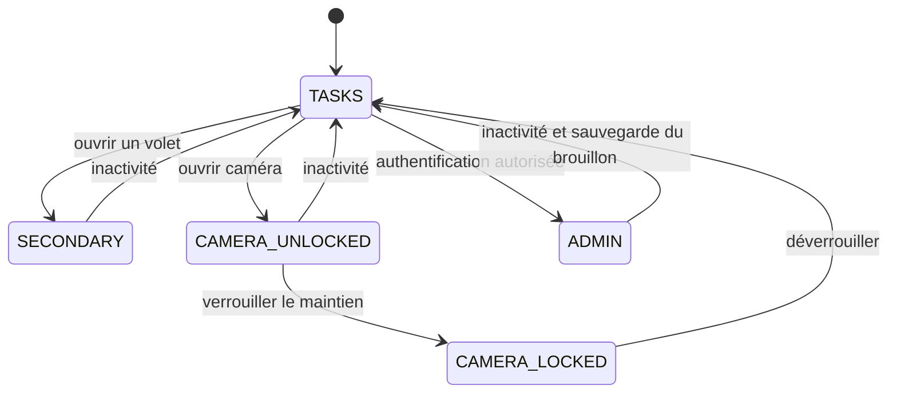
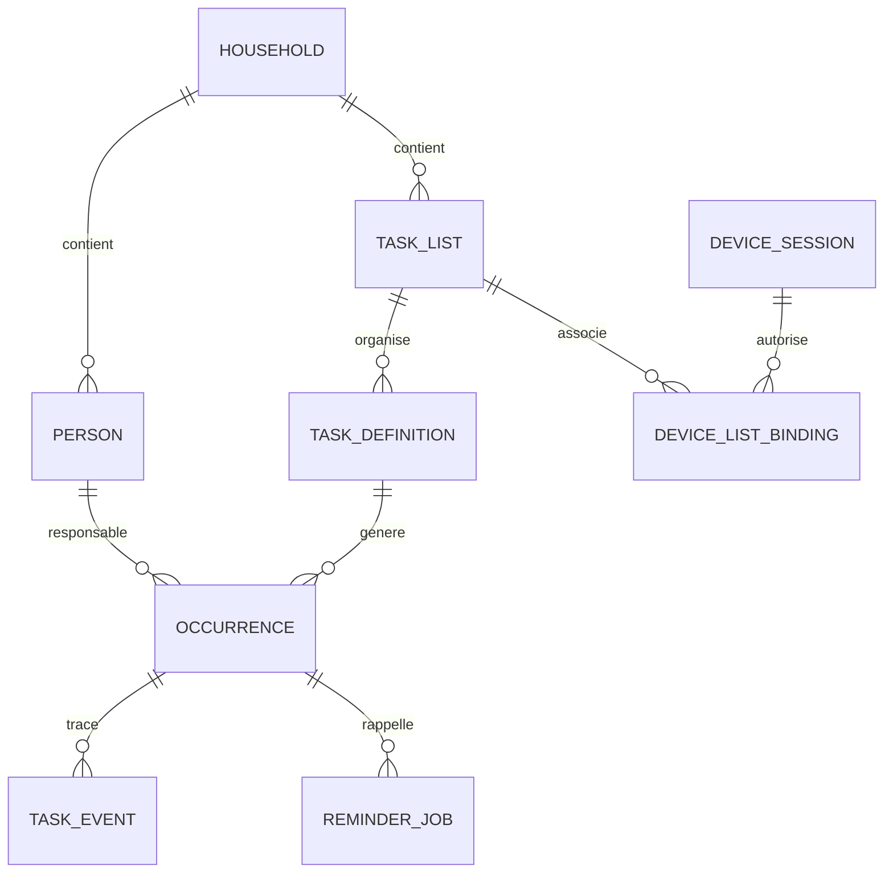

# Diagrammes logiques proposés V1.0

## Navigation du portail

## Responsabilités et occurrences

Le modèle JSON détaillé et les règles du cahier priment sur ces vues simplifiées. Les personnes qui valident restent distinctes des personnes responsables. Un report est un événement sur une occurrence ouverte ; une réalisation, un saut et une annulation sont des issues distinctes.
